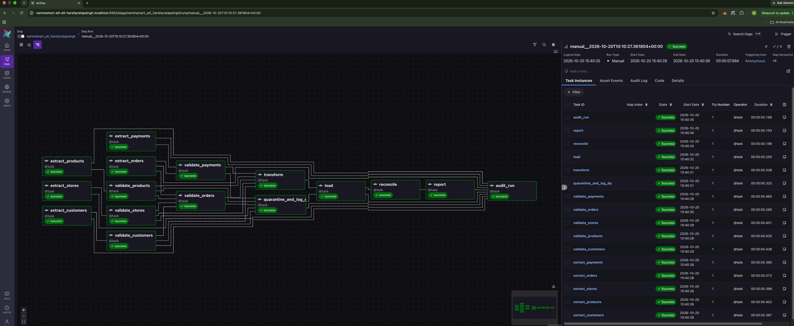
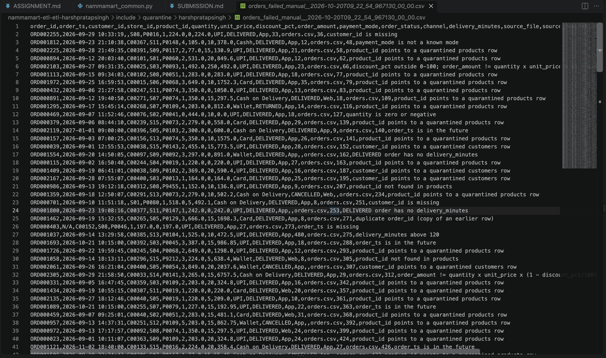
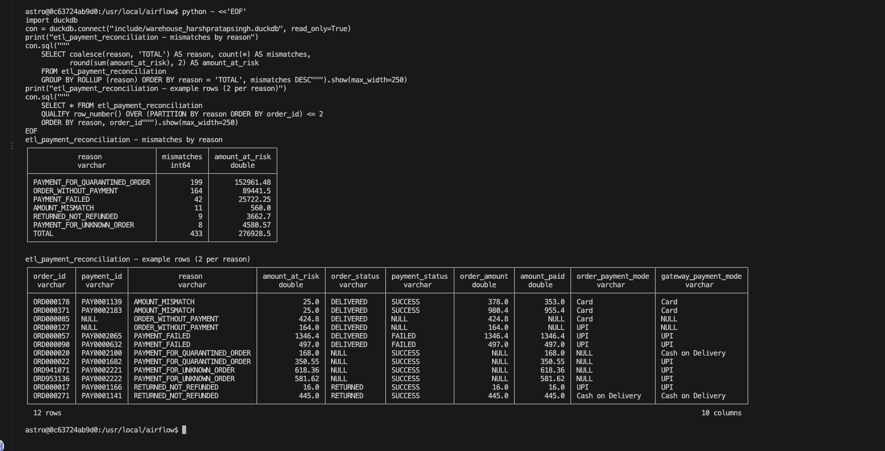
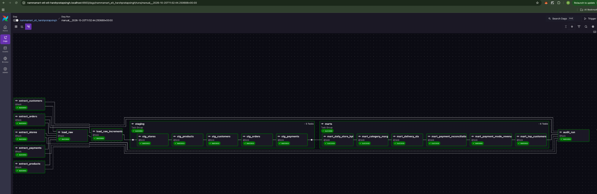
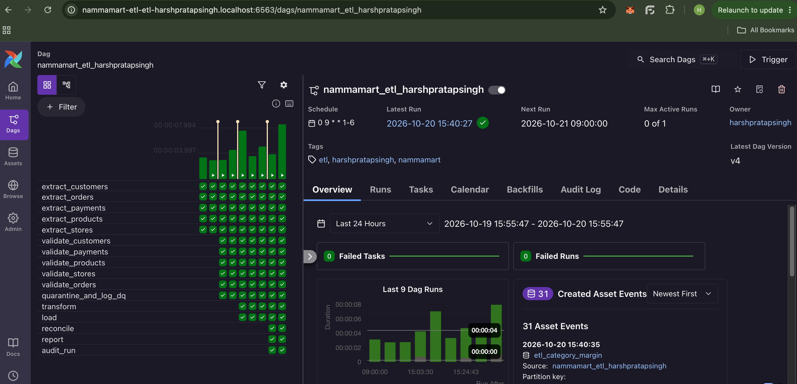
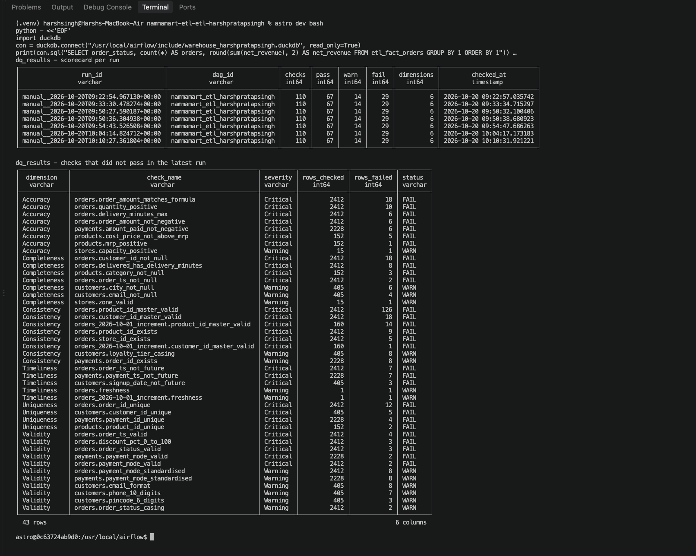
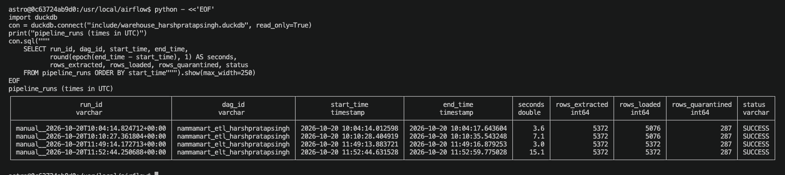

# NammaMart Quick Commerce: ETL & ELT Pipeline Submission

**Learner:** Harsh Pratap Singh
**Module:** FDAIE Module 2, Data Engineering Foundations
**Repository:** https://github.com/harsh190897/nammamart-etl-etl-harshpratapsingh
**Assignment brief:** [assignment/ASSIGNMENT.md](assignment/ASSIGNMENT.md)

---

## Submission checklist

Status of every item in section 6 of the assignment brief. ✅ done · 🟡 in progress · ⬜ not started

| # | Checklist item (ASSIGNMENT.md §6) | Status | Where |
|---|---|---|---|
| 1 | `dags/nammamart_etl_harshpratapsingh.py`, parsing with no import errors | ✅ Complete (16 tasks), no import errors | [dags/nammamart_etl_harshpratapsingh.py](dags/nammamart_etl_harshpratapsingh.py) |
| 2 | `dags/nammamart_elt_harshpratapsingh.py`, parsing with no import errors | ✅ Complete (19 tasks: 5 extracts, raw, staging, marts, run audit), no import errors | [dags/nammamart_elt_harshpratapsingh.py](dags/nammamart_elt_harshpratapsingh.py) |
| 3 | Helper code in `include/` (quality checks, masking functions) | ✅ ETL helpers (quality rules, masking, transform, load, reconciliation, reports, audit tables) and ELT helpers (SQL runner, rule variables) | [include/nammamart_common.py](include/nammamart_common.py), [include/nammamart_elt.py](include/nammamart_elt.py), [include/nammamart_etl_checks.py](include/nammamart_etl_checks.py), [include/nammamart_etl_transform.py](include/nammamart_etl_transform.py), [include/nammamart_etl_load.py](include/nammamart_etl_load.py) |
| 4 | SQL files in `include/sql/` | ✅ Raw, staging, data quality and mart SQL (16 files) | [include/sql/](include/sql/) |
| 5 | `SUBMISSION.md`: Data Issues Log (Part 0) | ✅ | [Part 0](#part-0-discovery-and-data-profiling) |
| 6 | `SUBMISSION.md`: answers to Part C | ✅ Answered, with schedule screenshot | [Part C](#part-c-scheduling) |
| 7 | `SUBMISSION.md`: governance answers (Part E) | ✅ | [Part E](#part-e-data-governance) |
| 8 | `SUBMISSION.md`: observability results table (Part F) | ✅ | [Part F](#part-f-observability-tests) |
| 9 | `SUBMISSION.md`: recommendation (Part G) | ✅ | [Part G](#part-g-recommendation-to-the-cto) |
| 10 | Screenshots: both DAGs green in Graph view, 9:00 AM IST schedule, one quarantine file, `dq_results`, `pipeline_runs`, payment reconciliation | ✅ 7 of 7 | [Screenshots](#screenshots) |
| 11 | Six business questions, SQL + result, from both pipelines | ✅ All six answered from both pipelines; results identical | [Business questions](#business-questions) |
| 12 | No API keys, passwords, webhook URLs or unmasked customer data outside `include/data/` | ✅ Checked on every commit | [.gitignore](.gitignore) |

## Contents

- [Part 0: Discovery and data profiling](#part-0-discovery-and-data-profiling)
- [Part A: ETL pipeline](#part-a-etl-pipeline)
- [Part B: ELT pipeline](#part-b-elt-pipeline)
- [Part C: Scheduling](#part-c-scheduling)
- [Part D: Data quality dimensions](#part-d-data-quality-dimensions)
- [Business questions](#business-questions)
- [Part E: Data governance](#part-e-data-governance)
- [Part F: Observability tests](#part-f-observability-tests)
- [Part G: Recommendation to the CTO](#part-g-recommendation-to-the-cto)
- [Screenshots](#screenshots)

---

## Part 0: Discovery and data profiling

### 0.1 Approach and how to reproduce

Before writing any pipeline code, every file was profiled in plain Python (outside Airflow), so that the quality rules used later in the ETL and ELT pipelines come from evidence, not guesses.

- Every CSV is read **as text** (`dtype=str, keep_default_na=False`) so that blanks, placeholders, bad numbers and bad dates are seen exactly as the client sent them.
- Timeliness checks use a fixed "as of" date of **2026-10-02** (the day after the increment file), so results are repeatable.

| Script | Purpose |
|---|---|
| [`profiling/common.py`](profiling/common.py) | Shared file paths and a text-only CSV loader |
| [`profiling/profile_files.py`](profiling/profile_files.py) | Row counts, blanks per column, duplicate keys, min/max of numeric and date columns, distinct values of category columns |
| [`profiling/find_issues.py`](profiling/find_issues.py) | Referential-integrity and business-rule checks; writes the Data Issues Log |
| [`profiling/output/issues_log_summary.csv`](profiling/output/issues_log_summary.csv) | One row per issue type (the table in 0.5) |
| [`profiling/output/issues_log_detail.csv`](profiling/output/issues_log_detail.csv) | One row per bad record (row-level evidence) |

```bash
python3 -m venv .venv && source .venv/bin/activate && pip install pandas duckdb
python profiling/profile_files.py > profiling/profile_output.txt   # not committed: contains raw personal data
python profiling/find_issues.py
```

Row keys in the log are written as `<id>@row<N>`, where `N` is the line number in the CSV (line 1 is the header). This identifies the exact row even when the same ID appears twice.

### 0.2 Profiling summary

| File | Rows | Cols | Duplicate keys | Key profiling findings |
|---|---|---|---|---|
| `orders.csv` | 2,412 | 13 | 12 `order_id` (all exact copies) | `quantity` min −3; `discount_pct` max 250; `order_amount` min −1,593; `delivery_minutes` max 1,440; `order_ts` up to 2027-01-01 and unparseable values (`2026-13-05 11:00:00`, `31/09/2026 10:00`); status values `Pending??`, `delivered`; payment modes `upi`, `UPI ` (trailing space), `CARD`, `cod`, `Cashh`; 18 blank `customer_id`, 2 blank `order_ts`, 164 blank `delivery_minutes` |
| `payments.csv` | 2,228 | 7 | 4 `payment_id` (all exact copies) | `amount_paid` min −1,593; `payment_ts` up to 2027-01-01; same payment-mode variants as orders; 301 blank `gateway_ref` |
| `customers.csv` | 405 | 10 | 5 `customer_id` (rows differ in phone/area) | `loyalty_tier` in mixed case (`BRONZE`, `bronze`, `SILVER`); `pincode` values `0` and `5600XX`; `signup_date` up to 2027-01-05; 4 blank `email`, 6 blank `city` |
| `products.csv` | 152 | 10 | 2 `product_id` (`(old)` copies with a different `mrp`) | `mrp` min −203; 3 blank `category` |
| `stores.csv` | 15 | 8 | none | 1 blank `zone`; `capacity_orders_per_day` min 0 |
| `orders_2026-10-01_increment.csv` | 160 | 13 | none | Clean: no blanks, all values in range. 10 rows are corrections to existing orders (DELIVERED → RETURNED, amount unchanged); 150 are new orders |

### 0.3 Referential integrity

| Relationship | Result |
|---|---|
| `orders.customer_id` → `customers.customer_id` | 18 orders have a blank `customer_id`; every non-blank ID exists |
| `orders.product_id` → `products.product_id` | 9 orders reference a product that does not exist |
| `orders.store_id` → `stores.store_id` | 5 orders reference a store that does not exist |
| `payments.order_id` → `orders.order_id` | 8 payments reference an order that does not exist; in the other direction, 28 DELIVERED/RETURNED orders have no payment record. No CANCELLED order has a payment, as expected |

### 0.4 Business-rule checks

| Rule from the client | Result |
|---|---|
| `order_amount = quantity × unit_price × (1 − discount_pct/100)`, rounded to 2 decimals | 18 orders do not match (tolerance ₹0.01) |
| Valid `order_status`: DELIVERED, CANCELLED, RETURNED | 3 invalid (`Pending??`); 2 valid but lower case (`delivered`) |
| Valid `payment_mode`: UPI, Card, Cash on Delivery, Wallet | 2 unrecognised (`Cashh`) in each of orders and payments; 8 fixable variants in each (case, trailing space, `cod`) |
| Deliveries take 8–35 minutes; DELIVERED orders must have `delivery_minutes` | 6 orders above 120 minutes (up to 1,440); 8 DELIVERED orders with no delivery time; no values between 35 and 120 or below 8 |
| A SUCCESS payment must equal its order's `order_amount` | 14 SUCCESS payments differ from the order amount; 6 payments have a negative `amount_paid` |
| Increment file contains new orders and corrections | Confirmed: 150 new + 10 status corrections, no quality issues |

### 0.5 Data Issues Log

40 issue types and 259 affected records, across all five data files (orders 151, payments 51, customers 44, products 11, stores 2). Example keys only are listed here; the full row-level list is in [`issues_log_detail.csv`](profiling/output/issues_log_detail.csv).

**Critical** = the row is quarantined. **Warning** = the row is loaded (after standardisation where possible) and the issue is logged.

| # | File | Row key (examples) | Column | Problem | Quality dimension | Proposed rule | Severity | Rows |
|---|---|---|---|---|---|---|---|---|
| 1 | `orders.csv` | ORD002255@row36, ORD000701@row251, ORD000997@row550 | `customer_id` | Missing customer_id | Completeness | customer_id NOT NULL | Critical | 18 |
| 2 | `orders.csv` | ORD001554@row162, ORD001800@row253, ORD000731@row652 | `delivery_minutes` | DELIVERED order without delivery_minutes | Completeness | DELIVERED => delivery_minutes NOT NULL | Critical | 8 |
| 3 | `orders.csv` | ORD000403@row273, ORD000362@row899 | `order_ts` | Missing order_ts | Completeness | order_ts NOT NULL | Critical | 2 |
| 4 | `orders.csv` | ORD001462@row271, ORD001441@row1121, ORD001692@row1318 | `order_id` | Exact duplicate row | Uniqueness | Drop repeated copy, keep first | Critical | 12 |
| 5 | `orders.csv` | ORD002103@row66, ORD001468@row2131, ORD001237@row2292 | `discount_pct` | Discount outside 0-100 | Validity | 0 <= discount_pct <= 100 | Critical | 3 |
| 6 | `orders.csv` | ORD000500@row747, ORD001970@row2027, ORD001637@row2129 | `order_status` | Invalid status (e.g. 'Pending??') | Validity | status IN (DELIVERED, CANCELLED, RETURNED) | Critical | 3 |
| 7 | `orders.csv` | ORD001610@row513, ORD000534@row825, ORD002012@row1100 | `order_ts` | Unparseable timestamp (bad format or month) | Validity | order_ts must parse as timestamp | Critical | 4 |
| 8 | `orders.csv` | ORD001812@row48, ORD001414@row563 | `payment_mode` | Unrecognised payment_mode (e.g. 'Cashh') | Validity | Quarantine or ask client | Critical | 2 |
| 9 | `orders.csv` | ORD001066@row143, ORD000153@row1881 | `order_status` | Valid status but wrong casing (e.g. 'delivered') | Validity | TRIM + UPPER before validating | Warning | 2 |
| 10 | `orders.csv` | ORD000159@row886, ORD001364@row1473, ORD000433@row2003 | `payment_mode` | Mode needs standardising (case/space/'cod') | Validity | Map to UPI/Card/Cash on Delivery/Wallet | Warning | 8 |
| 11 | `orders.csv` | ORD001037@row275, ORD002101@row511, ORD000455@row626 | `delivery_minutes` | Impossible delivery time (> 120 min) | Accuracy | delivery_minutes < 120 | Critical | 6 |
| 12 | `orders.csv` | ORD001296@row801, ORD001459@row816, ORD000867@row860 | `order_amount` | Negative order_amount | Accuracy | order_amount >= 0 | Critical | 6 |
| 13 | `orders.csv` | ORD002103@row66, ORD002305@row312, ORD002004@row480 | `order_amount` | order_amount != qty x price x (1-disc/100) | Accuracy | Recompute and compare (tolerance 0.01) | Critical | 18 |
| 14 | `orders.csv` | ORD000469@row127, ORD001296@row801, ORD001459@row816 | `quantity` | Quantity zero or negative | Accuracy | quantity > 0 | Critical | 10 |
| 15 | `orders.csv` | ORD000986@row207, ORD001058@row305, ORD001685@row590 | `product_id` | product_id not found in products | Consistency | FK product_id -> products | Critical | 9 |
| 16 | `orders.csv` | ORD001799@row735, ORD001046@row742, ORD001492@row831 | `store_id` | store_id not found in stores | Consistency | FK store_id -> stores | Critical | 5 |
| 17 | `orders.csv` | ORD001113, ORD000737, ORD001398 | `order_id` | DELIVERED/RETURNED order has no payment record | Consistency | Goes to reconciliation table | Warning | 28 |
| 18 | `orders.csv` | ORD002119@row140, ORD001693@row288, ORD001089@row363 | `order_ts` | order_ts in the future (after 2026-10-02) | Timeliness | order_ts <= run time | Critical | 7 |
| 19 | `payments.csv` | PAY0000509@row1032, PAY0001651@row1855, PAY0002000@row1877 | `payment_id` | Exact duplicate row | Uniqueness | Drop repeated copy, keep first | Critical | 4 |
| 20 | `payments.csv` | PAY0000522@row1454, PAY0000044@row1625 | `payment_mode` | Unrecognised payment_mode | Validity | Quarantine or ask client | Critical | 2 |
| 21 | `payments.csv` | PAY0002188@row96, PAY0001850@row609, PAY0001954@row822 | `payment_mode` | Mode needs standardising | Validity | Map to standard names | Warning | 8 |
| 22 | `payments.csv` | PAY0001568@row71, PAY0002175@row346, PAY0000751@row434 | `amount_paid` | Negative amount_paid | Accuracy | amount_paid >= 0 (refunds should be status REFUNDED) | Critical | 6 |
| 23 | `payments.csv` | PAY0001568@ORD001031, PAY0000354@ORD001937, PAY0000779@ORD001840 | `amount_paid` | SUCCESS payment amount != order_amount | Consistency | Report in the payment reconciliation table (AMOUNT_MISMATCH), see 0.7 | Warning | 14 |
| 24 | `payments.csv` | PAY0002219@row188, PAY0002220@row689, PAY0002223@row966 | `order_id` | Payment for an order that does not exist | Consistency | FK order_id -> orders; report in the payment reconciliation table, see 0.7 | Warning | 8 |
| 25 | `payments.csv` | PAY0000522, PAY0000044 | `payment_mode` | Payment mode differs from the order's mode | Consistency | Modes should match | Warning | 2 |
| 26 | `payments.csv` | PAY0000396@row146, PAY0000127@row309, PAY0001908@row411 | `payment_ts` | payment_ts in the future | Timeliness | payment_ts <= run time | Critical | 7 |
| 27 | `customers.csv` | C00355@row4, C00394@row202, C00233@row276 | `city` | Missing city | Completeness | Warn | Warning | 6 |
| 28 | `customers.csv` | C00337@row17, C00045@row81, C00327@row199 | `email` | Missing email | Completeness | Warn; mask nothing | Warning | 4 |
| 29 | `customers.csv` | C00103@row46, C00252@row215, C00226@row246 | `customer_id` | Duplicate customer_id (rows differ in phone/area) | Uniqueness | One row per customer_id; keep latest/first, log conflict | Critical | 5 |
| 30 | `customers.csv` | C00307@row24, C00063@row79, C00363@row82 | `email` | Invalid email format | Validity | Email regex | Warning | 8 |
| 31 | `customers.csv` | C00151@row60, C00240@row117, C00095@row141 | `phone` | Phone is not 10 digits | Validity | phone = 10 digits | Warning | 7 |
| 32 | `customers.csv` | C00132@row38, C00083@row109, C00166@row151 | `pincode` | Pincode is not 6 digits | Validity | pincode = 6 digits | Warning | 3 |
| 33 | `customers.csv` | C00199@row2, C00171@row40, C00133@row43 | `loyalty_tier` | Inconsistent casing (BRONZE/bronze/SILVER) | Consistency | Standardise to Title case | Warning | 8 |
| 34 | `customers.csv` | C00400@row86, C00398@row197, C00038@row239 | `signup_date` | signup_date in the future | Timeliness | signup_date <= run time | Critical | 3 |
| 35 | `products.csv` | P0051@row52, P0060@row61, P0068@row69 | `category` | Missing category | Completeness | category NOT NULL | Critical | 3 |
| 36 | `products.csv` | P0030@row152, P0140@row153 | `product_id` | Duplicate product_id ('(old)' rows with different mrp) | Uniqueness | One row per product_id; drop '(old)' version | Critical | 2 |
| 37 | `products.csv` | P0019@row20, P0073@row74, P0074@row75 | `cost_price` | cost_price greater than mrp | Accuracy | cost_price <= mrp | Critical | 5 |
| 38 | `products.csv` | P0109@row110 | `mrp` | mrp zero or negative | Accuracy | mrp > 0 | Critical | 1 |
| 39 | `stores.csv` | S07@row8 | `zone` | Missing zone | Completeness | Keep the store; show zone as 'Unknown' and log it, see 0.7 | Warning | 1 |
| 40 | `stores.csv` | S12@row13 | `capacity_orders_per_day` | Capacity is zero | Accuracy | capacity > 0 | Warning | 1 |

### 0.6 Questions for the client before building

1. **Duplicate records with different content.** "Five customers appear twice with the same `customer_id` but a different phone number and area, and two products have an `(old)` copy with a different MRP. Which version is correct: the latest one, the first one, or is there an 'active' flag we should use?"
2. **Negative quantities and negative payments.** "Some orders have quantity 0 or negative and a negative order amount, and some payments have a negative `amount_paid`, yet most are marked DELIVERED. Are these returns or refunds that should be recorded as `RETURNED`/`REFUNDED`, or data-entry errors to reject?"
3. **Orders and payments that don't match.** "28 delivered or returned orders have no payment, 8 payments point to orders we can't find, and 14 successful payments differ from the order amount. Is the gateway export incomplete or delayed, or are these real collection problems finance needs to chase? And should a mismatched order still count as revenue?"

### 0.7 Severity changes made when designing the pipelines

Three proposed severities in the log above were changed from Critical to Warning while designing the pipelines (the rows are already updated). Each one would otherwise have removed valid data from the finance tables:

| Issue | First proposal | Final rule | Reason |
|---|---|---|---|
| `stores.csv`: S07 has no `zone` | Critical | Warning; zone shown as `Unknown` | S07 is a real store with 176 orders (about 7% of all orders). Quarantining it would hide all of them from revenue; only the zone label is missing |
| `payments.csv`: payment for an order that does not exist | Critical | Warning; listed in the payment reconciliation table | The payment record itself is valid. The mismatch is a finance question, and the reconciliation table is where finance looks for it |
| `payments.csv`: SUCCESS payment ≠ order amount | Critical | Listed in the payment reconciliation table | It needs both files to detect, so it is a reconciliation finding, not a fault in one row |

---

## Part A: ETL pipeline

**Status:** ✅ complete (A.1–A.4).

**DAG:** [`dags/nammamart_etl_harshpratapsingh.py`](dags/nammamart_etl_harshpratapsingh.py), flow **Extract → Validate → Transform → Load**.
**Helper code:** [`include/nammamart_common.py`](include/nammamart_common.py) (paths, business rules, DuckDB connection, masking, audit tables), [`include/nammamart_etl_checks.py`](include/nammamart_etl_checks.py) (data quality rules in pandas), [`include/nammamart_etl_transform.py`](include/nammamart_etl_transform.py) (standardise, mask, join, derive in pandas), [`include/nammamart_etl_load.py`](include/nammamart_etl_load.py) (star schema load, reconciliation and reports in DuckDB SQL).

| Step | Status | Tasks |
|---|---|---|
| A.1 Extract | ✅ | `extract_customers`, `extract_products`, `extract_stores`, `extract_orders`, `extract_payments` (run in parallel) |
| A.2 Validate + quarantine | ✅ | `validate_customers`, `validate_products`, `validate_stores`, `validate_orders`, `validate_payments`, `quarantine_and_log_dq` |
| A.3 Transform + load (star schema) | ✅ | `transform`, `load` |
| A.4 Reconcile, report, run audit | ✅ | `reconcile`, `report`, `audit_run` |

```
extract_customers ─► validate_customers ─┐
extract_products  ─► validate_products  ─┼─► validate_orders ─┬─► quarantine_and_log_dq ─┐
extract_stores    ─► validate_stores    ─┘         ▲          │                          ├─► load ─► reconcile ─► report ─► audit_run
extract_orders    ─────────────────────────────────┘          └─► transform ─────────────┘
extract_payments  ─► validate_payments (also uses extract_orders)
```

Green run in the Airflow UI (Graph view, all 16 tasks `success`):



**Extract (A.1).** Each task copies its source file into a per-run folder (`include/tmp/harshpratapsingh/<run_id>/extract/`), reads it as text, checks the header against the expected columns, and passes only the file path and row count to the next task. `extract_orders` also picks up every next-day file matching `orders_*_increment.csv`.

**Validate (A.2).** Every file is checked row by row with the rules in [Part D](#part-d-data-quality-dimensions). A row that fails any **Critical** check is set aside with a `failure_reason` listing every rule it broke; **Warning** checks are only counted. The three master files are validated first, because an order is only valid if its customer, product and store exist **and** passed their own checks. Payments only need the order IDs from the orders files, so `validate_payments` runs in parallel with the master validations.

**Quarantine (A.2).** `quarantine_and_log_dq` writes the failed rows of each file, exactly as received plus `source_file`, `source_row` and `failure_reason`, to `include/quarantine/harshpratapsingh/<file>_failed_<run_id>.csv`, and writes every check to `dq_results`. It is the only task in this step that writes to the warehouse, so DuckDB never has two writers.

Example quarantine file (`orders_failed_<run_id>.csv`; the last column is `failure_reason`):



Result of a run on 2026-10-20:

| File | Rows | Passed | Quarantined | Main reasons |
|---|---|---|---|---|
| `customers.csv` | 405 | 397 | 8 | 5 duplicate `customer_id`, 3 future `signup_date` |
| `products.csv` | 152 | 142 | 10 | 2 duplicate `(old)` rows, 3 missing category, 5 cost > mrp, 1 mrp ≤ 0 |
| `stores.csv` | 15 | 15 | 0 | S07's missing zone is a Warning (see 0.7) |
| `orders.csv` | 2,412 | 2,177 | 235 | 126 point to a quarantined product, 18 missing customer, 18 amount ≠ formula, 12 duplicates, … |
| `orders_2026-10-01_increment.csv` | 160 | 145 | 15 | 14 point to a quarantined product, 1 to a quarantined customer |
| `payments.csv` | 2,228 | 2,209 | 19 | 4 duplicates, 6 negative amounts, 7 future-dated, 2 unknown mode `Cashh` |

**Transform (A.3, pandas).** Runs on the passed rows only, in parallel with `quarantine_and_log_dq`:

- **Standardise:** trim every value; `order_status` upper case; `loyalty_tier` title case; payment modes mapped (`upi`, `UPI `, `CARD`, `cod` → `UPI`, `UPI`, `Card`, `Cash on Delivery`); placeholders such as `N/A` become NULL; a missing store zone or customer city becomes `Unknown`.
- **Deduplicate:** one row per `customer_id`, `product_id` and `store_id` (validation already quarantined the later copies; the transform step is a safety net, and every dimension also has a `PRIMARY KEY`).
- **Mask PII:** `email_masked` (`pr***@example.com`), `phone_masked` (`98******21`) and `name_masked` (`D*** D***`) are added and the raw `email`, `phone` and `full_name` columns are dropped before anything is written.
- **Join and derive:** orders are joined to products for `cost_price`, then `order_date`, `net_revenue` (`order_amount` for DELIVERED orders, else 0), `gross_margin` (`net_revenue − quantity × cost_price`) and `within_15_min` (DELIVERED only) are derived.
- **Next-day files:** orders from `orders.csv` and each increment file are combined in date order and the **latest version of each `order_id` wins**, so a correction such as DELIVERED → RETURNED replaces the old row. A fingerprint (`row_hash`) of the business columns is stored for the load step.

The typed tables are handed to `load` as Parquet files in the run folder.

**Load (A.3, DuckDB) into a star schema** in `include/warehouse_harshpratapsingh.duckdb`, inside **one transaction** (all tables or nothing):

| Table | Grain | Load method |
|---|---|---|
| `etl_fact_orders` | one row per order | **MERGE on `order_id`**: new order → insert; same order with a different `row_hash` → update; identical → untouched |
| `etl_dim_customer` | one row per customer (masked) | full refresh (the master file is a full export) |
| `etl_dim_product` | one row per product | full refresh |
| `etl_dim_store` | one row per store | full refresh |
| `etl_fact_payments` | one row per payment (used for reconciliation) | full refresh |

Every fact row keeps `source_file`, `source_row`, `run_id` and `loaded_at`, so any number can be traced back to the exact CSV line and the run that loaded it. The `load` task declares the five tables as **Airflow Assets** (group `nammamart_etl`), so the Assets page shows each table, the task that produces it and the time of its last successful load.

Results of runs on 2026-10-20:

| Run | `load` log | `etl_fact_orders` rows |
|---|---|---|
| First run | 2,313 inserted, 0 updated, 0 unchanged | 2,313 |
| Re-run with the same files (idempotency) | **0 inserted, 0 updated, 2,313 unchanged** | 2,313 |
| Day 1: `orders.csv` only (test) | 2,177 inserted | 2,177 |
| Day 2: increment file added (test) | **136 inserted, 9 updated, 2,168 unchanged** | 2,313 |

Of the 10 corrections in the increment file, 9 were applied; the tenth points to a quarantined product and is in the increment's quarantine file. Table sizes: `etl_dim_customer` 397, `etl_dim_product` 142, `etl_dim_store` 15, `etl_fact_payments` 2,209. `etl_fact_orders` holds 2,091 DELIVERED orders (net revenue ₹1,128,410.45), 147 CANCELLED and 75 RETURNED.

**Reconcile (A.4).** `reconcile` compares every order in `etl_fact_orders` with every payment in `etl_fact_payments` (a full outer join on `order_id`) and rebuilds `etl_payment_reconciliation` on every run: one row per mismatch, with a `reason` and the `amount_at_risk`.

| Reason | Rule | Amount at risk | Rows (2026-10-20) | ₹ at risk |
|---|---|---|---|---|
| `PAYMENT_FOR_QUARANTINED_ORDER` | Payment whose order exists in the source file but was quarantined | amount paid | 199 | 152,961.48 |
| `ORDER_WITHOUT_PAYMENT` | DELIVERED or RETURNED order with no payment | order amount | 164 | 89,441.50 |
| `PAYMENT_FAILED` | DELIVERED order whose payment FAILED | order amount | 42 | 25,722.25 |
| `AMOUNT_MISMATCH` | SUCCESS payment ≠ order amount (more than ₹0.01) | difference | 11 | 560.00 |
| `RETURNED_NOT_REFUNDED` | RETURNED order whose payment is still SUCCESS | amount paid | 9 | 3,662.70 |
| `PAYMENT_FOR_UNKNOWN_ORDER` | Payment whose `order_id` is in no orders file | amount paid | 8 | 4,580.57 |
| `REFUNDED_BUT_DELIVERED`, `PAID_BUT_CANCELLED`, `PAYMENT_MODE_MISMATCH` | Checked on every run | | 0 | 0 |

Of the 164 orders without a payment, 28 are September orders (the same 28 found in profiling) and 136 are new orders from 1 October: the payments export ends at 2026-09-30 23:47, so their payments have not arrived yet. The 9 `RETURNED_NOT_REFUNDED` rows are exactly the 9 DELIVERED → RETURNED corrections applied from the increment file. Their payments are still `SUCCESS`, so finance should check whether the refunds were issued.



**Report (A.4).** `report` rebuilds two reporting tables and prints them in the task log:

- `etl_daily_zone_revenue`: net revenue and delivered orders per day, zone and store (459 rows).
- `etl_category_margin`: delivered orders, units, revenue, cost, gross margin and margin % per category (6 rows).

The total of both tables equals the DELIVERED net revenue in `etl_fact_orders` (₹1,128,410.45), which is checked by a unit test. `reconcile` and `report` also publish their tables as Airflow Assets, so the Assets page shows 8 `nammamart_etl` tables.

**Run audit (A.4).** `audit_run` uses `trigger_rule="all_done"`, so it runs even when an upstream task failed, and writes one row per run to `pipeline_runs` (see [Part F](#part-f-observability-tests)). If the run did not reach the report, it records `FAILED` and then fails itself, so the DAG run is shown as failed instead of green. It also deletes run folders in `include/tmp/` that are older than 3 days.

---

## Part B: ELT pipeline

**Status:** ✅ complete (B.1–B.4).

**DAG:** [`dags/nammamart_elt_harshpratapsingh.py`](dags/nammamart_elt_harshpratapsingh.py), flow **Extract → Load raw → Transform in the warehouse with SQL**. Same schedule settings as the ETL DAG (see [Part C](#part-c-scheduling)).
**Helper code:** [`include/nammamart_elt.py`](include/nammamart_elt.py) (file snapshot and header check, and a runner that executes `.sql` files in one transaction with the run's parameters). **SQL:** [`include/sql/`](include/sql/).

| Step | Status | Tasks | SQL |
|---|---|---|---|
| B.1 Extract + raw layer | ✅ | `extract_customers`, `extract_products`, `extract_stores`, `extract_orders`, `extract_payments` (parallel), `load_raw`, `load_raw_increments` | [`raw/raw_tables.sql`](include/sql/raw/raw_tables.sql), [`raw/load_raw.sql`](include/sql/raw/load_raw.sql), [`raw/load_raw_increments.sql`](include/sql/raw/load_raw_increments.sql) |
| B.2 Staging layer + data quality in SQL | ✅ | `staging.stg_stores` → `stg_products` → `stg_customers` → `stg_orders` → `stg_payments` (task group, one after another) | [`common/macros.sql`](include/sql/common/macros.sql), [`common/dq_setup.sql`](include/sql/common/dq_setup.sql), [`staging/stg_*.sql`](include/sql/staging/) |
| B.3 Mart layer + run audit | ✅ | `marts.mart_daily_store_kpis` → `mart_category_margin` → `mart_delivery_sla` → `mart_payment_reconciliation` → `mart_payment_mode_revenue` → `mart_top_customers` (task group), `audit_run` | [`marts/mart_*.sql`](include/sql/marts/) |
| B.4 ETL vs ELT comparison | ✅ | [`analysis/business_questions.py`](analysis/business_questions.py) | [`analysis/sql/`](analysis/sql/) |

Green run in the Airflow UI (Graph view, `staging` and `marts` task groups expanded, all 19 tasks `success`):



**Extract (B.1).** Each task copies its source file into the run folder (`include/tmp/harshpratapsingh/<run_id>/elt/extract/`) and checks only the header line with Python's `csv` module. Nothing is parsed or cleaned. `extract_orders` also picks up next-day files matching `orders_*_increment.csv`.

**Raw layer (B.1).** `load_raw` loads the five files into `raw_customers`, `raw_products`, `raw_stores`, `raw_orders` and `raw_payments` with DuckDB SQL, in one transaction:

- Every column is read and stored as **text** (`read_csv(..., all_varchar = true)`); empty cells stay empty strings. A unit test compares every cell of every raw table with its source file, so the raw tables are an **exact copy**, bad rows included (for example `payment_mode = 'UPI '` with the trailing space, `order_ts = 'N/A'`, 18 empty `customer_id`).
- Four metadata columns are added: `_source_file`, `_source_row` (CSV line number, header = line 1), `_run_id` and `_loaded_at` (UTC). Together they trace any row back to the exact file line and the run that loaded it.
- Columns are matched by name (`INSERT ... BY NAME`), so a renamed or missing column fails the task with a clear error, and the transaction loads nothing.
- Raw is **append-only**: every run adds its own batch, and nothing is ever updated or deleted. Each file is loaded only once per run, so a retried or cleared task never duplicates a batch. Staging reads only the current run's batch, so the growth of raw never double-counts anything.

**Incremental load, raw step (B.1).** `load_raw_increments` is a separate step that **appends** `orders_2026-10-01_increment.csv` to `raw_orders`, keeping its own `_source_file`. If there is no increment file, the step logs that and succeeds.

Result of a run on 2026-10-20 (rows per run): `raw_customers` 405, `raw_products` 152, `raw_stores` 15, `raw_orders` 2,412 + 160 (increment), `raw_payments` 2,228. A second run with the same files appends a second batch of the same size (`raw_orders` 2,572 → 5,144 rows in total).

**Staging layer (B.2), SQL only.** Each staging task runs three SQL files: [`common/macros.sql`](include/sql/common/macros.sql) (small SQL functions for cleaning, type conversion and PII masking), [`common/dq_setup.sql`](include/sql/common/dq_setup.sql) (the rule catalog `elt_dq_rules` and the `stg_rejected_rows` table) and its own [`staging/stg_<table>.sql`](include/sql/staging/). Each staging file reads only **this run's batch** of its raw table and follows the same four steps:

1. **Type, standardise and check.** Cast types (`TRY_CAST`, `try_strptime` with the exact formats), trim values, map payment modes (`upi`, `UPI `, `cod` → `UPI`, `UPI`, `Cash on Delivery`), title-case `loyalty_tier`, turn placeholders such as `N/A` into NULL, show a missing store zone or customer city as `Unknown`, and **mask PII** in SQL (`mask_email`, `mask_phone`, `mask_name`; the raw columns are not carried into staging). Every rule becomes one TRUE/FALSE column named `fail__<rule>`.
2. **failure_reason.** The `fail__` columns are unpivoted and joined to the rule catalog; the reasons of every Critical rule a row breaks are joined in rule order.
3. **Results.** One `dq_results` row per rule (and per file for orders), plus the file-level **freshness** and **volume** checks; every rejected row (duplicate copies included) is listed in `stg_rejected_rows` with its file, CSV line and reason. Re-running the same run replaces its rows, so retries never create duplicates.
4. **Staging table.** One row per key (later copies of a duplicate are removed), with `dq_status` (`VALID` / `REJECTED`) and `failure_reason`. Rejected rows are **kept and flagged**, not deleted; the marts will use only `VALID` rows.

The rule catalog holds the **same 72 row rules plus 2 file-level checks (freshness, volume)** as the ETL pipeline (same names, dimensions, severities, order and reason text), and every threshold and allowed list (120 minutes, 8–35 minutes, ₹0.01, 24 hours, 90 %, valid statuses, modes, zones, tiers) is passed to the SQL from `include/nammamart_common.py`, so a rule is changed in one place for both pipelines.

**Incremental load, staging step (B.2): MERGE on `order_id`.** `stg_orders` is a persistent table. For each order the latest **valid** version wins (a next-day file is newer than `orders.csv`); if no version is valid, the latest version is kept as `REJECTED`. The batch is then merged with a fingerprint (`row_hash`) of the source values and the quality result: new order → **insert**, changed order → **update**, identical order → untouched.

| Run | MERGE result | `stg_orders` |
|---|---|---|
| First run (both files) | 2,550 inserted, 0 updated | 2,550 orders (2,313 VALID, 237 REJECTED) |
| Re-run with the same files | **0 inserted, 0 updated, 2,550 unchanged** | 2,550 |
| Day 1 without the increment file (test) | 2,400 inserted | 2,400 |
| Day 2 with the increment file (test) | **150 inserted, 10 updated** | 2,550, no duplicates; e.g. `ORD000017` is now `RETURNED`, `_source_file = orders_2026-10-01_increment.csv` |

ELT updates all 10 corrections (one of them is rejected, but staging keeps rejected rows with their flag), while the ETL fact table updated 9 (it holds only valid rows).

**Same result as ETL.** A unit test runs the ETL Python rules and the ELT SQL on the same files and checks that they agree exactly:

| | ETL | ELT |
|---|---|---|
| Checks in `dq_results` (name, dimension, severity, rows checked, rows failed) | 110 | 110, identical |
| Rejected rows (file, line, reason text) | 287 quarantined | 287 in `stg_rejected_rows`, identical |
| Valid orders | 2,313 in `etl_fact_orders` | 2,313 `VALID` in `stg_orders`, same IDs, status, amount, mode and source file |
| Delivered net revenue | ₹1,128,410.45 | ₹1,128,410.45 |
| Masked name / email / phone of the 397 valid customers | | identical |

Staging tables after a run: `stg_customers` 397 VALID + 3 REJECTED, `stg_products` 142 + 8, `stg_stores` 15 + 0, `stg_orders` 2,313 + 237, `stg_payments` 2,209 + 15.

**Mart layer (B.3), SQL only.** Six business-ready tables, each built by one SQL file in [`include/sql/marts/`](include/sql/marts/) from the **VALID** staging rows only, and rebuilt in full on every run (so they always match staging and never double-count):

| Mart | Grain | Answers | Rows |
|---|---|---|---|
| `mart_daily_store_kpis` | day × store: delivered orders, net revenue, gross margin, average delivery minutes, orders and % within 15 minutes | Q1 (daily net revenue by zone and store) | 459 |
| `mart_category_margin` | category: delivered orders, units, revenue, cost, gross margin, margin % | Q2 | 6 |
| `mart_delivery_sla` | store: delivered orders, average / fastest / slowest delivery, orders and % within 15 minutes | Q3 | 15 |
| `mart_payment_reconciliation` | one row per order/payment mismatch, with reason and amount at risk (same rules as ETL) | Q4, acceptance criterion 7 | 433 |
| `mart_payment_mode_revenue` | payment mode: delivered orders, net revenue, mismatches, amount not reconciled | Q4 | 4 |
| `mart_top_customers` | customer: spend rank, masked name, loyalty tier, city, delivered orders, total spend (no email or phone) | Q5 | 396 |

`mart_payment_mode_revenue` is one extra mart beyond the five in the brief: none of the five has a payment-mode breakdown, and it makes Q4 a single simple query. Q6 (rows rejected today, by file and reason) is answered from `stg_rejected_rows`.

**Same numbers as ETL.** A unit test builds the ETL report tables and the ELT marts from the same files in one database and checks them row by row: `mart_daily_store_kpis` equals `etl_daily_zone_revenue` (all 459 day × store rows), `mart_category_margin` equals `etl_category_margin`, and `mart_payment_reconciliation` equals `etl_payment_reconciliation` (433 mismatches, ₹276,928.50 at risk). Net revenue (₹1,128,410.45), gross margin (₹277,758.40) and the 15-minute SLA counts are the same in both pipelines, and every mart adds up to the same revenue.

**Run audit (B.3).** `audit_run` (`trigger_rule="all_done"`) writes one row per run to `pipeline_runs`, like the ETL DAG. In ELT `rows_loaded` is the number of rows written to the raw tables: ELT loads **every** row it receives (5,372), and `rows_quarantined` is the number of rows rejected in staging (287, listed in `stg_rejected_rows`). If the marts were not built, the audit records `FAILED` and fails itself, so the run is shown as failed.

**Both DAGs at 09:00.** The two DAGs write to the same DuckDB file, which allows one writer at a time. When both were started together, the ELT DAG found the warehouse locked once, waited and retried (`get_connection` retries for up to 30 seconds), and both runs succeeded with their own `dq_results` and `pipeline_runs` rows.

**Assets.** The DAG publishes 17 tables as Airflow Assets in group `nammamart_elt` (5 raw, 5 staging, `stg_rejected_rows`, 6 marts), so the Assets page shows every ELT table and the task that produces it.

**ETL vs ELT for September (B.4).** The brief requires the ELT mart totals to match the ETL totals for September. They match exactly, in the latest run of each DAG:

| September 2026 (delivered orders) | ETL | ELT | Difference |
|---|---|---|---|
| Delivered orders | 1,955 | 1,955 | 0 |
| Net revenue | ₹1,056,219.25 | ₹1,056,219.25 | 0.00 |
| Gross margin | ₹258,846.51 | ₹258,846.51 | 0.00 |
| Delivered within 15 minutes | 548 | 548 | 0 |
| Day × store rows that differ (`etl_daily_zone_revenue` vs `mart_daily_store_kpis`) | 444 | 444 | 0 |

Every zone matches as well (see the [business questions](#business-questions) section, which is generated from the warehouse by [`analysis/business_questions.py`](analysis/business_questions.py) together with the six answers). September excludes the 136 valid new orders dated 1 October from the increment file; both pipelines include them in their all-dates totals (₹1,128,410.45).

**Why they match.** Both pipelines apply the same rules with the same thresholds (taken from `include/nammamart_common.py`), the same duplicate handling (first copy kept), the same "master row must be valid" rule for orders, the same "latest valid version of an order wins" rule for next-day files, and the same formulas (net revenue = `order_amount` of DELIVERED orders; margin rounded per order). Unit tests check that the two pipelines agree check by check, row by row and table by table, so any future change that makes them drift apart fails a test.

**What is different (by design, not in the totals).** ELT loads all 5,372 rows into raw and keeps the 287 rejected rows inside the warehouse (`stg_*` with `dq_status = 'REJECTED'`, and `stg_rejected_rows`), while ETL loads 5,076 rows and writes the 287 rejected rows to quarantine CSV files. In the incremental test ELT's MERGE updated 10 orders and ETL's updated 9: the tenth correction belongs to a rejected order, which ELT keeps (flagged) and ETL does not hold at all.

---

## Part C: Scheduling

**Status:** ✅ answered for the ETL DAG; the ELT DAG will use the same settings.

Both DAGs in the Airflow UI (display timezone +05:30, bottom-left): schedule `0 9 * * 1-6`, next run `2026-10-21 09:00:00` IST.



| Setting | Value | Why |
|---|---|---|
| `schedule` | `"0 9 * * 1-6"` | 09:00, Monday to Saturday |
| `start_date` | `pendulum.datetime(2026, 10, 1, tz="Asia/Kolkata")` | Makes Airflow read the cron in IST |
| `catchup` | `False` | Do not create runs for past days (see below) |
| `retries` / `retry_delay` | 2 / 1 minute | A missing file or a locked warehouse often clears within minutes |
| `execution_timeout` | 10 minutes per task | A hung task is stopped instead of blocking the report |
| `dagrun_timeout` | 25 minutes | A run not finished by 09:25 is marked failed, before the 09:30 review |
| `max_active_runs` | 1 | A manual run and the scheduled run never write to the warehouse at the same time |

**Why `catchup=False`.** Every run reads the same full set of files, so back-filling one run per missed day since `start_date` would only reload identical data and delay today's run. If a day is missed, one run with the latest files is what the business needs.

**1. What is your cron expression?**
`0 9 * * 1-6`: minute 0, hour 9, every day of the month, every month, days of the week 1–6 (Monday to Saturday).

**2. What time does the run show in UTC in the Airflow UI?**
**03:30 UTC.** IST is UTC+5:30 with no daylight saving, so 09:00 IST is always 03:30 UTC. Observed on 2026-10-20: the scheduled run is named `scheduled__2026-10-20T03:30:00+00:00`.

**3. What would happen at 9 AM if you had left the `start_date` in UTC?**
Airflow would read `0 9 * * 1-6` as 09:00 **UTC**, which is **14:30 IST**: five hours after the 09:30 review, every day. Nothing at 9 AM IST would show that anything was wrong; the numbers would simply arrive in the afternoon.

**4. What happens if your laptop or Docker is off at 9 AM?**
The scheduler is not running, so nothing runs at 09:00 and the numbers are not ready for the review. When Airflow starts again, because `catchup=False` it creates **one** run for the most recent missed schedule (not one per missed day) and starts it straight away. Observed on 2026-10-20: when the DAG was unpaused in the afternoon, after 09:00 IST had already passed, Airflow immediately ran `scheduled__2026-10-20T03:30:00+00:00` (started 08:51 UTC = 14:21 IST), and only that one run. In production Airflow should run on an always-on server or a managed service, with an alert when the 09:00 run has not succeeded by 09:25.

---

## Part D: Data quality dimensions

**Status:** ✅ ETL (Python) and ELT (SQL) checks done; both write the same 110 checks to `dq_results` on every run.

**Critical** = the row is quarantined with a `failure_reason`. **Warning** = the row is loaded and the problem is counted. Every check, of either severity, writes one row to `dq_results` on every run (`run_id`, `dag_id`, `check_name`, `dimension`, `severity`, `rows_checked`, `rows_failed`, `status`, `checked_at`); `status` is PASS, WARN (Warning check with failures) or FAIL (Critical check with failures). Check names are `<file>.<rule>`, for example `orders.order_amount_matches_formula`.

**ETL checks (Python, [`include/nammamart_etl_checks.py`](include/nammamart_etl_checks.py))**

| Dimension | Critical (quarantine) | Warning (load + log) |
|---|---|---|
| Completeness | Key not missing in all 5 files; order `customer_id`, `order_ts`, `quantity`, `unit_price`, `discount_pct`, `order_amount`; DELIVERED order has `delivery_minutes`; payment `order_id` | Missing `email` or `city`; store `zone`; online SUCCESS payment without `gateway_ref`; orders volume dropped > 90% vs the previous run |
| Uniqueness | `order_id`, `payment_id`, `customer_id`, `product_id`, `store_id` (first copy kept, later copies quarantined) | — |
| Validity | `order_ts`, `payment_ts` (`YYYY-MM-DD HH:MM:SS`) and `signup_date` (`YYYY-MM-DD`) parse; `order_status` and `payment_status` in the allowed lists; `payment_mode` maps to UPI / Card / Cash on Delivery / Wallet; numeric columns are numbers; whole-number `quantity`; `discount_pct` 0–100; known `loyalty_tier` | Status or mode needed standardising (`delivered`, `upi`, `UPI `, `cod`); email format; phone 10 digits; pincode 6 digits; `channel` App/Web; `is_active` Y/N; `is_perishable` True/False |
| Accuracy | `quantity` > 0; `unit_price` > 0; `order_amount` = quantity × unit_price × (1 − discount/100) within ₹0.01; `order_amount` ≥ 0; `delivery_minutes` ≤ 120; `mrp` > 0; `cost_price` ≤ `mrp`; `amount_paid` ≥ 0 | `delivery_minutes` outside 8–35; store capacity ≤ 0 |
| Consistency | Order's `customer_id`, `product_id`, `store_id` exist in the master file **and** point to a master row that passed its own checks | `loyalty_tier` casing; payment for an order not in the orders files (listed in reconciliation) |
| Timeliness | No future `order_ts`, `payment_ts` or `signup_date` (compared with Bengaluru time) | Freshness: newest order older than 24 hours |

Result of a run on 2026-10-20: **110 checks**, all 6 dimensions, **29 FAIL, 14 WARN, 67 PASS**. The failure counts match the [Data Issues Log](#05-data-issues-log) exactly (verified by [`tests/test_nammamart_etl.py`](tests/test_nammamart_etl.py)).

Query result: the `dq_results` scorecard of every run of both DAGs, and the latest run of each DAG by quality dimension (ETL and ELT identical):



**ELT checks (SQL, [`include/sql/common/dq_setup.sql`](include/sql/common/dq_setup.sql) + [`include/sql/staging/`](include/sql/staging/))**

The ELT pipeline implements **the same checks in SQL**: same names, dimensions, severities and reasons, listed once in the rule catalog table `elt_dq_rules`. Each staging file computes one TRUE/FALSE column per rule, and generic SQL turns them into `failure_reason`, `dq_status` and the `dq_results` rows (with `dag_id = nammamart_elt_harshpratapsingh`). A unit test checks that, on the same files, the two pipelines report identical results for all 110 checks and reject the same 287 rows for the same reasons. The one difference is the meaning of Critical: ETL removes the row before loading (quarantine file), ELT keeps it in staging with `dq_status = 'REJECTED'` and lists it in `stg_rejected_rows`; in both cases it never reaches the reporting tables.

---

## Business questions

Each question is answered with **one query on the final tables of each pipeline**: the ETL star schema and report tables (`etl_*`), and the ELT marts (`mart_*`, `stg_rejected_rows`). For every question the script runs both queries and checks that they return the same rows; open **SQL** under each question to see both queries.

To refresh this section after a new run (with no DAG running): `python analysis/business_questions.py --update-submission`.

<!-- business-questions:start -->

Results below are from the latest successful run of each DAG: `nammamart_elt_harshpratapsingh` run `partF_final_clean_run__elt_124040`; `nammamart_etl_harshpratapsingh` run `partF_final_clean_run__etl_124040`. Generated by [`analysis/business_questions.py`](analysis/business_questions.py) from the SQL in [`analysis/sql/`](analysis/sql/).

### Q1. Daily net revenue by zone and by store (delivered orders only, after discount)

✅ ETL and ELT return **identical** results.

<details><summary>SQL</summary>

**ETL** ([`analysis/sql/q1_etl.sql`](analysis/sql/q1_etl.sql))

```sql
-- Q1 (ETL): daily net revenue by zone and by store (delivered orders only, after discount).
SELECT order_date, zone, store_id, store_name, delivered_orders, net_revenue
FROM etl_daily_zone_revenue
ORDER BY order_date, zone, store_id;
```

**ELT** ([`analysis/sql/q1_elt.sql`](analysis/sql/q1_elt.sql))

```sql
-- Q1 (ELT): daily net revenue by zone and by store (delivered orders only, after discount).
SELECT order_date, zone, store_id, store_name, delivered_orders, net_revenue
FROM mart_daily_store_kpis
ORDER BY order_date, zone, store_id;
```

</details>

**Result (ETL and ELT):**

| order_date | zone | store_id | store_name | delivered_orders | net_revenue |
|---|---|---|---|---|---|
| 2026-09-01 | East | S08 | NammaMart Whitefield | 4 | 2,984.70 |
| 2026-09-01 | East | S09 | NammaMart Indiranagar | 4 | 2,089.60 |
| 2026-09-01 | East | S10 | NammaMart Marathahalli | 3 | 2,141.60 |
| 2026-09-01 | East | S11 | NammaMart HSR Layout | 6 | 2,121.15 |
| 2026-09-01 | North | S01 | NammaMart Hebbal | 3 | 1,410.80 |
| 2026-09-01 | North | S02 | NammaMart Yelahanka | 6 | 2,385.55 |
| 2026-09-01 | North | S03 | NammaMart RT Nagar | 6 | 4,583.80 |
| 2026-09-01 | South | S05 | NammaMart JP Nagar | 2 | 803.00 |
| 2026-09-01 | South | S06 | NammaMart Banashankari | 6 | 2,812.00 |
| 2026-09-01 | Unknown | S07 | NammaMart BTM Layout | 9 | 5,844.75 |

_First 10 of 459 rows._

### Q2. Revenue and gross margin by product category (margin = revenue − quantity × cost_price)

✅ ETL and ELT return **identical** results.

<details><summary>SQL</summary>

**ETL** ([`analysis/sql/q2_etl.sql`](analysis/sql/q2_etl.sql))

```sql
-- Q2 (ETL): revenue and gross margin by product category (margin = revenue - quantity x cost_price).
SELECT category, delivered_orders, revenue, cost, gross_margin, margin_pct
FROM etl_category_margin
ORDER BY revenue DESC;
```

**ELT** ([`analysis/sql/q2_elt.sql`](analysis/sql/q2_elt.sql))

```sql
-- Q2 (ELT): revenue and gross margin by product category (margin = revenue - quantity x cost_price).
SELECT category, delivered_orders, revenue, cost, gross_margin, margin_pct
FROM mart_category_margin
ORDER BY revenue DESC;
```

</details>

**Result (ETL and ELT):**

| category | delivered_orders | revenue | cost | gross_margin | margin_pct |
|---|---|---|---|---|---|
| Staples | 300 | 264,456.90 | 198,021.62 | 66,435.28 | 25.12 |
| Household | 359 | 210,229.95 | 156,174.68 | 54,055.27 | 25.71 |
| Personal Care | 319 | 208,774.70 | 162,065.13 | 46,709.57 | 22.37 |
| Dairy & Bakery | 402 | 177,404.85 | 130,204.03 | 47,200.82 | 26.61 |
| Snacks & Beverages | 339 | 174,575.60 | 133,236.36 | 41,339.24 | 23.68 |
| Fruits & Vegetables | 372 | 92,968.45 | 70,950.23 | 22,018.22 | 23.68 |

### Q3. Average delivery time per store, and the % of delivered orders within 15 minutes

✅ ETL and ELT return **identical** results.

<details><summary>SQL</summary>

**ETL** ([`analysis/sql/q3_etl.sql`](analysis/sql/q3_etl.sql))

```sql
-- Q3 (ETL): average delivery time per store, and the % of delivered orders within 15 minutes.
SELECT s.zone, f.store_id, s.store_name,
       count(*)                                                              AS delivered_orders,
       round(avg(f.delivery_minutes), 1)                                     AS avg_delivery_minutes,
       round(100.0 * count(*) FILTER (WHERE f.within_15_min) / count(*), 1)  AS pct_within_15_min
FROM etl_fact_orders AS f
JOIN etl_dim_store AS s USING (store_id)
WHERE f.order_status = 'DELIVERED'
GROUP BY ALL
ORDER BY s.zone, f.store_id;
```

**ELT** ([`analysis/sql/q3_elt.sql`](analysis/sql/q3_elt.sql))

```sql
-- Q3 (ELT): average delivery time per store, and the % of delivered orders within 15 minutes.
SELECT zone, store_id, store_name, delivered_orders, avg_delivery_minutes, pct_within_15_min
FROM mart_delivery_sla
ORDER BY zone, store_id;
```

</details>

**Result (ETL and ELT):**

| zone | store_id | store_name | delivered_orders | avg_delivery_minutes | pct_within_15_min |
|---|---|---|---|---|---|
| East | S08 | NammaMart Whitefield | 155 | 20.60 | 35.50 |
| East | S09 | NammaMart Indiranagar | 127 | 21.10 | 27.60 |
| East | S10 | NammaMart Marathahalli | 141 | 21.90 | 27.00 |
| East | S11 | NammaMart HSR Layout | 144 | 21.00 | 27.80 |
| North | S01 | NammaMart Hebbal | 141 | 20.60 | 31.20 |
| North | S02 | NammaMart Yelahanka | 139 | 21.00 | 30.90 |
| North | S03 | NammaMart RT Nagar | 137 | 20.70 | 29.20 |
| South | S04 | NammaMart Jayanagar | 130 | 21.60 | 26.90 |
| South | S05 | NammaMart JP Nagar | 134 | 21.20 | 29.10 |
| South | S06 | NammaMart Banashankari | 145 | 22.30 | 22.10 |
| Unknown | S07 | NammaMart BTM Layout | 143 | 21.10 | 33.60 |
| West | S12 | NammaMart Rajajinagar | 113 | 22.00 | 23.90 |
| West | S13 | NammaMart Malleshwaram | 137 | 21.80 | 27.00 |
| West | S14 | NammaMart Vijayanagar | 162 | 21.50 | 31.50 |
| West | S15 | NammaMart Basaveshwaranagar | 143 | 22.30 | 21.00 |

### Q4. Revenue by payment mode, and the total amount that doesn't reconcile with the payment gateway

✅ ETL and ELT return **identical** results.

<details><summary>SQL</summary>

**ETL** ([`analysis/sql/q4_etl.sql`](analysis/sql/q4_etl.sql))

```sql
-- Q4 (ETL): revenue by payment mode, and the amount that does not reconcile with the payment gateway.
-- A mismatch is assigned to the order's payment mode, or to the gateway's when there is no valid order.
WITH revenue AS (
    SELECT payment_mode, count(*) AS delivered_orders, sum(net_revenue) AS net_revenue
    FROM etl_fact_orders
    WHERE order_status = 'DELIVERED'
    GROUP BY payment_mode
),
not_reconciled AS (
    SELECT coalesce(order_payment_mode, gateway_payment_mode) AS payment_mode,
           count(*) AS mismatches, sum(amount_at_risk) AS amount_not_reconciled
    FROM etl_payment_reconciliation
    GROUP BY 1
),
per_mode AS (
    SELECT coalesce(r.payment_mode, n.payment_mode) AS payment_mode,
           coalesce(r.delivered_orders, 0) AS delivered_orders, coalesce(r.net_revenue, 0) AS net_revenue,
           coalesce(n.mismatches, 0) AS mismatches, coalesce(n.amount_not_reconciled, 0) AS amount_not_reconciled
    FROM revenue AS r FULL OUTER JOIN not_reconciled AS n USING (payment_mode)
)
SELECT coalesce(payment_mode, 'TOTAL') AS payment_mode, CAST(sum(delivered_orders) AS BIGINT) AS delivered_orders,
       round(sum(net_revenue), 2) AS net_revenue, CAST(sum(mismatches) AS BIGINT) AS mismatches,
       round(sum(amount_not_reconciled), 2) AS amount_not_reconciled
FROM per_mode
GROUP BY ROLLUP (payment_mode)
ORDER BY payment_mode IS NULL, net_revenue DESC;
```

**ELT** ([`analysis/sql/q4_elt.sql`](analysis/sql/q4_elt.sql))

```sql
-- Q4 (ELT): revenue by payment mode, and the amount that does not reconcile with the payment gateway.
SELECT coalesce(payment_mode, 'TOTAL') AS payment_mode, CAST(sum(delivered_orders) AS BIGINT) AS delivered_orders,
       round(sum(net_revenue), 2) AS net_revenue, CAST(sum(mismatches) AS BIGINT) AS mismatches,
       round(sum(amount_not_reconciled), 2) AS amount_not_reconciled
FROM mart_payment_mode_revenue
GROUP BY ROLLUP (payment_mode)
ORDER BY payment_mode IS NULL, net_revenue DESC;
```

</details>

**Result (ETL and ELT):**

| payment_mode | delivered_orders | net_revenue | mismatches | amount_not_reconciled |
|---|---|---|---|---|
| UPI | 1,131 | 598,618.20 | 208 | 127,400.55 |
| Card | 428 | 231,787.85 | 100 | 55,502.60 |
| Cash on Delivery | 298 | 169,026.60 | 70 | 63,143.05 |
| Wallet | 234 | 128,977.80 | 55 | 30,882.30 |
| TOTAL | 2,091 | 1,128,410.45 | 433 | 276,928.50 |

### Q5. Top 10 customers by spend, with loyalty tier (no raw email or phone shown)

✅ ETL and ELT return **identical** results.

<details><summary>SQL</summary>

**ETL** ([`analysis/sql/q5_etl.sql`](analysis/sql/q5_etl.sql))

```sql
-- Q5 (ETL): top 10 customers by spend, with loyalty tier. Only the masked name is shown (no email or phone).
SELECT row_number() OVER (ORDER BY sum(f.net_revenue) DESC, f.customer_id) AS spend_rank,
       f.customer_id, c.name_masked, c.loyalty_tier,
       count(*) AS delivered_orders, round(sum(f.net_revenue), 2) AS total_spend
FROM etl_fact_orders AS f
JOIN etl_dim_customer AS c USING (customer_id)
WHERE f.order_status = 'DELIVERED'
GROUP BY f.customer_id, c.name_masked, c.loyalty_tier
ORDER BY spend_rank
LIMIT 10;
```

**ELT** ([`analysis/sql/q5_elt.sql`](analysis/sql/q5_elt.sql))

```sql
-- Q5 (ELT): top 10 customers by spend, with loyalty tier. Only the masked name is shown (no email or phone).
SELECT spend_rank, customer_id, name_masked, loyalty_tier, delivered_orders, total_spend
FROM mart_top_customers
WHERE spend_rank <= 10
ORDER BY spend_rank;
```

</details>

**Result (ETL and ELT):**

| spend_rank | customer_id | name_masked | loyalty_tier | delivered_orders | total_spend |
|---|---|---|---|---|---|
| 1 | C00136 | S*** B*** | Bronze | 9 | 8,738.10 |
| 2 | C00236 | S*** N*** | Platinum | 12 | 7,831.80 |
| 3 | C00115 | S*** K*** | Bronze | 7 | 7,337.70 |
| 4 | C00310 | K*** P*** | Bronze | 8 | 7,258.95 |
| 5 | C00265 | V*** H*** | Gold | 8 | 7,151.30 |
| 6 | C00338 | B*** I*** | Silver | 9 | 6,848.55 |
| 7 | C00283 | N*** R*** | Bronze | 7 | 6,766.40 |
| 8 | C00357 | A*** N*** | Bronze | 11 | 6,637.90 |
| 9 | C00209 | K*** P*** | Platinum | 8 | 6,519.40 |
| 10 | C00072 | N*** M*** | Silver | 11 | 6,433.95 |

### Q6. Number of rows rejected today, by file and by reason

✅ ETL and ELT return **identical** results.

<details><summary>SQL</summary>

**ETL** ([`analysis/sql/q6_etl.sql`](analysis/sql/q6_etl.sql))

```sql
-- Q6 (ETL): rows rejected in the latest successful ETL run, by file and by reason.
-- The ETL pipeline keeps rejected rows in quarantine CSV files, so this query reads those files
-- (getvariable('quarantine_glob') = include/quarantine/harshpratapsingh/*_failed_*.csv).
-- "(all reasons)" is the number of rejected rows; a row that broke two rules also counts once under each reason.
WITH latest AS (
    SELECT trim(regexp_replace(run_id, '[^A-Za-z0-9_-]+', '_', 'g'), '_') AS file_run_id
    FROM pipeline_runs
    WHERE dag_id = 'nammamart_etl_harshpratapsingh' AND status = 'SUCCESS'
    ORDER BY start_time DESC
    LIMIT 1
),
rejected AS (
    SELECT q.source_file, q.failure_reason
    FROM read_csv(getvariable('quarantine_glob'), union_by_name = true, all_varchar = true, filename = true) AS q
    CROSS JOIN latest
    WHERE parse_filename(q.filename) = regexp_replace(q.source_file, '\.csv$', '') || '_failed_' || latest.file_run_id || '.csv'
),
by_reason AS (
    SELECT source_file, unnest(string_split(failure_reason, '; ')) AS reason FROM rejected
)
SELECT * FROM (
    SELECT source_file, '(all reasons)' AS reason, count(*) AS rows_rejected FROM rejected GROUP BY ALL
    UNION ALL
    SELECT source_file, reason, count(*) FROM by_reason GROUP BY ALL
)
ORDER BY source_file, reason <> '(all reasons)', rows_rejected DESC, reason;
```

**ELT** ([`analysis/sql/q6_elt.sql`](analysis/sql/q6_elt.sql))

```sql
-- Q6 (ELT): rows rejected in the latest successful ELT run, by file and by reason (from stg_rejected_rows).
-- "(all reasons)" is the number of rejected rows; a row that broke two rules also counts once under each reason.
WITH latest AS (
    SELECT run_id
    FROM pipeline_runs
    WHERE dag_id = 'nammamart_elt_harshpratapsingh' AND status = 'SUCCESS'
    ORDER BY start_time DESC
    LIMIT 1
),
rejected AS (
    SELECT r.source_file, r.failure_reason
    FROM stg_rejected_rows AS r JOIN latest ON r._run_id = latest.run_id
),
by_reason AS (
    SELECT source_file, unnest(string_split(failure_reason, '; ')) AS reason FROM rejected
)
SELECT * FROM (
    SELECT source_file, '(all reasons)' AS reason, count(*) AS rows_rejected FROM rejected GROUP BY ALL
    UNION ALL
    SELECT source_file, reason, count(*) FROM by_reason GROUP BY ALL
)
ORDER BY source_file, reason <> '(all reasons)', rows_rejected DESC, reason;
```

</details>

**Result (ETL and ELT):**

| source_file | reason | rows_rejected |
|---|---|---|
| customers.csv | (all reasons) | 8 |
| customers.csv | duplicate customer_id (copy of an earlier row) | 5 |
| customers.csv | signup_date is in the future | 3 |
| orders.csv | (all reasons) | 235 |
| orders.csv | product_id points to a quarantined products row | 126 |
| orders.csv | customer_id is missing | 18 |
| orders.csv | customer_id points to a quarantined customers row | 18 |
| orders.csv | order_amount != quantity x unit_price x (1 - discount_pct/100) | 18 |
| orders.csv | duplicate order_id (copy of an earlier row) | 12 |
| orders.csv | quantity is zero or negative | 10 |
| orders.csv | product_id not found in products | 9 |
| orders.csv | DELIVERED order has no delivery_minutes | 8 |
| orders.csv | order_ts is in the future | 7 |
| orders.csv | delivery_minutes above 120 | 6 |
| orders.csv | order_amount is negative | 6 |
| orders.csv | store_id not found in stores | 5 |
| orders.csv | order_ts is not a valid YYYY-MM-DD HH:MM:SS timestamp | 4 |
| orders.csv | discount_pct outside 0-100 | 3 |
| orders.csv | order_status is not DELIVERED/CANCELLED/RETURNED | 3 |
| orders.csv | order_ts is missing | 2 |
| orders.csv | payment_mode is not a known mode | 2 |
| orders_2026-10-01_increment.csv | (all reasons) | 15 |
| orders_2026-10-01_increment.csv | product_id points to a quarantined products row | 14 |
| orders_2026-10-01_increment.csv | customer_id points to a quarantined customers row | 1 |
| payments.csv | (all reasons) | 19 |
| payments.csv | payment_ts is in the future | 7 |
| payments.csv | amount_paid is negative | 6 |
| payments.csv | duplicate payment_id (copy of an earlier row) | 4 |
| payments.csv | payment_mode is not a known mode | 2 |
| products.csv | (all reasons) | 10 |
| products.csv | cost_price is greater than mrp | 5 |
| products.csv | category is missing | 3 |
| products.csv | duplicate product_id (copy of an earlier row) | 2 |
| products.csv | mrp is zero or negative | 1 |

### ETL vs ELT totals for September 2026 (Part B4)

<details><summary>SQL</summary>

```sql
-- Part B4: ELT mart totals vs ETL totals for September 2026 (delivered orders, order_date 1-30 September).
-- Values are formatted as text so counts and rupee amounts can share one table.
WITH etl AS (
    SELECT count(*) AS delivered_orders, sum(net_revenue) AS net_revenue, sum(gross_margin) AS gross_margin,
           count(*) FILTER (WHERE within_15_min) AS within_15_min
    FROM etl_fact_orders
    WHERE order_status = 'DELIVERED' AND order_date BETWEEN DATE '2026-09-01' AND DATE '2026-09-30'
),
elt AS (
    SELECT CAST(sum(delivered_orders) AS BIGINT) AS delivered_orders, sum(net_revenue) AS net_revenue,
           sum(gross_margin) AS gross_margin, CAST(sum(orders_within_15_min) AS BIGINT) AS within_15_min
    FROM mart_daily_store_kpis
    WHERE order_date BETWEEN DATE '2026-09-01' AND DATE '2026-09-30'
),
day_store_diff AS (
    SELECT count(*) AS n FROM (
        (SELECT order_date, store_id, delivered_orders, net_revenue FROM etl_daily_zone_revenue
         WHERE order_date BETWEEN DATE '2026-09-01' AND DATE '2026-09-30'
         EXCEPT
         SELECT order_date, store_id, delivered_orders, net_revenue FROM mart_daily_store_kpis
         WHERE order_date BETWEEN DATE '2026-09-01' AND DATE '2026-09-30')
        UNION ALL
        (SELECT order_date, store_id, delivered_orders, net_revenue FROM mart_daily_store_kpis
         WHERE order_date BETWEEN DATE '2026-09-01' AND DATE '2026-09-30'
         EXCEPT
         SELECT order_date, store_id, delivered_orders, net_revenue FROM etl_daily_zone_revenue
         WHERE order_date BETWEEN DATE '2026-09-01' AND DATE '2026-09-30'))
)
SELECT 'Delivered orders' AS metric, format('{:,}', etl.delivered_orders) AS etl,
       format('{:,}', elt.delivered_orders) AS elt, format('{:,}', elt.delivered_orders - etl.delivered_orders) AS difference
FROM etl, elt
UNION ALL
SELECT 'Net revenue (₹)', format('{:,.2f}', etl.net_revenue), format('{:,.2f}', elt.net_revenue),
       format('{:,.2f}', round(elt.net_revenue - etl.net_revenue, 2) + 0.0)
FROM etl, elt
UNION ALL
SELECT 'Gross margin (₹)', format('{:,.2f}', etl.gross_margin), format('{:,.2f}', elt.gross_margin),
       format('{:,.2f}', round(elt.gross_margin - etl.gross_margin, 2) + 0.0)
FROM etl, elt
UNION ALL
SELECT 'Delivered within 15 minutes', format('{:,}', etl.within_15_min), format('{:,}', elt.within_15_min),
       format('{:,}', elt.within_15_min - etl.within_15_min)
FROM etl, elt
UNION ALL
SELECT 'Day × store rows that differ (ETL report vs ELT mart)', format('{:,}', n), format('{:,}', n), '0'
FROM day_store_diff;
```

```sql
-- Part B4: September 2026 net revenue by zone, ETL report table vs ELT mart.
WITH etl AS (
    SELECT zone, sum(delivered_orders) AS orders, sum(net_revenue) AS revenue
    FROM etl_daily_zone_revenue
    WHERE order_date BETWEEN DATE '2026-09-01' AND DATE '2026-09-30'
    GROUP BY zone
),
elt AS (
    SELECT zone, sum(delivered_orders) AS orders, sum(net_revenue) AS revenue
    FROM mart_daily_store_kpis
    WHERE order_date BETWEEN DATE '2026-09-01' AND DATE '2026-09-30'
    GROUP BY zone
)
SELECT coalesce(zone, 'TOTAL') AS zone,
       CAST(sum(etl.orders) AS BIGINT) AS etl_orders, CAST(sum(elt.orders) AS BIGINT) AS elt_orders,
       round(sum(etl.revenue), 2) AS etl_net_revenue, round(sum(elt.revenue), 2) AS elt_net_revenue,
       round(sum(elt.revenue) - sum(etl.revenue), 2) + 0.0 AS difference
FROM etl FULL OUTER JOIN elt USING (zone)
GROUP BY ROLLUP (zone)
ORDER BY zone IS NULL, etl_net_revenue DESC;
```

</details>

| metric | etl | elt | difference |
|---|---|---|---|
| Delivered orders | 1,955 | 1,955 | 0 |
| Net revenue (₹) | 1,056,219.25 | 1,056,219.25 | 0.00 |
| Gross margin (₹) | 258,846.51 | 258,846.51 | 0.00 |
| Delivered within 15 minutes | 548 | 548 | 0 |
| Day × store rows that differ (ETL report vs ELT mart) | 0 | 0 | 0 |

| zone | etl_orders | elt_orders | etl_net_revenue | elt_net_revenue | difference |
|---|---|---|---|---|---|
| East | 517 | 517 | 271,139.95 | 271,139.95 | 0.00 |
| West | 522 | 522 | 270,322.30 | 270,322.30 | 0.00 |
| South | 387 | 387 | 225,606.30 | 225,606.30 | 0.00 |
| North | 391 | 391 | 215,332.65 | 215,332.65 | 0.00 |
| Unknown | 138 | 138 | 73,818.05 | 73,818.05 | 0.00 |
| TOTAL | 1,955 | 1,955 | 1,056,219.25 | 1,056,219.25 | 0.00 |

<!-- business-questions:end -->

---

## Part E: Data governance

**Status:** ✅ done. Every answer uses this pipeline as the example. The numbers come from the warehouse after the final clean run on 2026-10-20 (`partF_final_clean_run__etl/elt_124040`).

### E1. Ownership

| Dataset | Business owner (decides what "correct" means) | Technical owner |
|---|---|---|
| `orders.csv` | Operations (Kavya, COO) | Ordering app team, who produce the export |
| `payments.csv` | Finance (CFO) | Payment gateway integration |
| `customers.csv` | Customer/CRM team, with the privacy officer for personal data | CRM system |
| `products.csv` | Category and merchandising team (MRP, cost price) | Catalogue system |
| `stores.csv` | Operations (store operations) | Operations |
| Warehouse tables (`etl_*`, `raw_*`, `stg_*`, `mart_*`, `dq_results`, `pipeline_runs`) | Finance for revenue, margin and reconciliation; Operations for store KPIs and delivery SLA | The data engineering team (today, me) |

- **Who approves a rule change.** The business owner of the data approves a change to a quality rule; data engineering makes it. For example, the 120-minute delivery limit is an Operations rule, so the COO approves it.
- **How the change is made.** The limit is one constant, `MAX_DELIVERY_MINUTES` in [`nammamart_common.py`](include/nammamart_common.py). Both pipelines read it (ELT passes it to SQL as a variable), so a change is a single reviewed pull request with the tests re-run.
- **Where it is recorded.** The pull request with the approver's name is the record. Severity changes are also logged in [0.7](#07-severity-changes-made-when-designing-the-pipelines).

### E2. Data dictionary

Star schema built by the ETL DAG.
- Allowed values come from [`nammamart_common.py`](include/nammamart_common.py).
- **Source** is the file and column the value comes from.
- PII means the value identifies, or can be linked back to, a person.

**`etl_fact_orders`**: one row per order (latest valid version). Only rows that passed every Critical check.

| Column | Type | Meaning | Source | Allowed values / rule | PII |
|---|---|---|---|---|---|
| `order_id` | VARCHAR | Order key (primary key) | orders `order_id` | Unique, not null | No |
| `order_ts` | TIMESTAMP | When the order was placed (Bengaluru local time) | orders `order_ts` | `YYYY-MM-DD HH:MM:SS`, not in the future | No |
| `order_date` | DATE | Date part of `order_ts`, used for daily reports | derived | | No |
| `customer_id` | VARCHAR | Customer key → `etl_dim_customer` | orders `customer_id` | Exists in customers, not quarantined | **Yes** (pseudonymous key) |
| `store_id` | VARCHAR | Store key → `etl_dim_store` | orders `store_id` | Exists in stores | No |
| `product_id` | VARCHAR | Product key → `etl_dim_product` | orders `product_id` | Exists in products, not quarantined | No |
| `quantity` | INTEGER | Units ordered | orders `quantity` | > 0 | No |
| `unit_price` | DOUBLE | Price per unit (₹) | orders `unit_price` | > 0 | No |
| `discount_pct` | DOUBLE | Discount (%) | orders `discount_pct` | 0–100 | No |
| `order_amount` | DOUBLE | Amount charged (₹) | orders `order_amount` | ≥ 0 and = quantity × unit_price × (1 − discount_pct/100), within ₹0.01 | No |
| `cost_price` | DOUBLE | Product cost per unit at load time (₹) | products `cost_price` | ≤ MRP | No |
| `payment_mode` | VARCHAR | How the customer paid | orders `payment_mode` | UPI, Card, Cash on Delivery, Wallet | No |
| `order_status` | VARCHAR | Latest status | orders `order_status` (upper-cased) | DELIVERED, CANCELLED, RETURNED | No |
| `channel` | VARCHAR | Where the order was placed | orders `channel` | App, Web | No |
| `delivery_minutes` | DOUBLE | Minutes from order to delivery | orders `delivery_minutes` | Required if DELIVERED; ≤ 120 | No |
| `net_revenue` | DOUBLE | Revenue after discount (₹) | derived | `order_amount` if DELIVERED, else 0 | No |
| `gross_margin` | DOUBLE | Margin (₹) | derived | `order_amount − quantity × cost_price` if DELIVERED, else 0 | No |
| `within_15_min` | BOOLEAN | Delivered within the 15-minute promise | derived | `delivery_minutes ≤ 15`; NULL if not delivered | No |
| `source_file` | VARCHAR | File the row came from (lineage) | pipeline | `orders.csv` or `orders_<date>_increment.csv` | No |
| `source_row` | INTEGER | Line number in that file, header = line 1 (lineage) | pipeline | | No |
| `row_hash` | VARCHAR | MD5 of the 13 business columns; used to detect a changed order | pipeline | | No |
| `run_id` | VARCHAR | Airflow run that last inserted or updated the row | pipeline | | No |
| `loaded_at` | TIMESTAMP | When that run wrote the row (UTC) | pipeline | | No |

**`etl_fact_payments`**: one row per valid payment, rebuilt fully each run.

| Column | Type | Meaning | Source | Allowed values / rule | PII |
|---|---|---|---|---|---|
| `payment_id` | VARCHAR | Payment key | payments `payment_id` | Unique | No |
| `order_id` | VARCHAR | Order the payment is for | payments `order_id` | Warning if not in orders (goes to reconciliation) | No |
| `payment_ts` | TIMESTAMP | When the gateway recorded it | payments `payment_ts` | Not in the future | No |
| `payment_mode` | VARCHAR | Mode at the gateway | payments `payment_mode` (standardised, e.g. `COD` → `Cash on Delivery`) | UPI, Card, Cash on Delivery, Wallet | No |
| `amount_paid` | DOUBLE | Amount (₹) | payments `amount_paid` | ≥ 0 | No |
| `payment_status` | VARCHAR | Gateway outcome | payments `payment_status` | SUCCESS, FAILED, REFUNDED | No |
| `gateway_ref` | VARCHAR | Gateway transaction reference (not a card number) | payments `gateway_ref` | | No |
| `order_in_source` | BOOLEAN | The order exists in the order files | derived | | No |
| `source_file`, `source_row` | VARCHAR, INTEGER | Lineage, as in the fact table | pipeline | | No |

**`etl_dim_customer`**: one row per valid customer. Raw name, email and phone are **not** stored.

| Column | Type | Meaning | Source | Allowed values / rule | PII |
|---|---|---|---|---|---|
| `customer_id` | VARCHAR | Customer key | customers `customer_id` | Unique | **Yes** (pseudonymous) |
| `name_masked` | VARCHAR | Initials only, e.g. `D*** D***` | `mask_name(full_name)` | | **Yes** (masked) |
| `email_masked` | VARCHAR | e.g. `pr***@example.com` | `mask_email(email)` | Warning if missing or bad format | **Yes** (masked) |
| `phone_masked` | VARCHAR | e.g. `98******21` | `mask_phone(phone)` | Warning if not 10 digits | **Yes** (masked) |
| `city`, `area` | VARCHAR | Where the customer lives | customers | Warning if city missing | **Yes** (location) |
| `pincode` | VARCHAR | Postal code | customers | Warning if not 6 digits | **Yes** (location) |
| `signup_date` | DATE | Account creation date | customers | Not in the future | Yes (linked to a person) |
| `loyalty_tier` | VARCHAR | Loyalty level | customers (casing fixed) | Bronze, Silver, Gold, Platinum | Yes (linked to a person) |
| `is_active` | BOOLEAN | Account active | customers | | Yes (linked to a person) |

**`etl_dim_product`**: one row per valid product.

| Column | Type | Meaning | Source | Allowed values / rule | PII |
|---|---|---|---|---|---|
| `product_id` | VARCHAR | Product key | products | Unique | No |
| `product_name`, `brand` | VARCHAR | Name and brand | products | | No |
| `category`, `sub_category` | VARCHAR | Catalogue grouping (used in Q2) | products | `category` not null | No |
| `mrp` | DOUBLE | Maximum retail price (₹) | products | > 0 | No |
| `cost_price` | DOUBLE | NammaMart's cost (₹) | products | ≤ `mrp` | No |
| `unit` | VARCHAR | Pack unit (kg, pack, …) | products | | No |
| `is_perishable` | BOOLEAN | Perishable item | products | | No |
| `launch_date` | DATE | Date first sold | products | | No |

**`etl_dim_store`**: one row per store.

| Column | Type | Meaning | Source | Allowed values / rule | PII |
|---|---|---|---|---|---|
| `store_id` | VARCHAR | Store key | stores | Unique | No |
| `store_name`, `area`, `pincode` | VARCHAR | Store name and location | stores | | No |
| `zone` | VARCHAR | Reporting zone | stores | North, South, East, West; missing → `Unknown` (Warning) | No |
| `open_date` | DATE | Store opening date | stores | | No |
| `manager_name` | VARCHAR | Store manager | stores | | **Yes** (employee name) |
| `capacity_orders_per_day` | INTEGER | Daily order capacity | stores | > 0 (Warning) | No |

**ELT equivalents.**
- `raw_*` tables hold every source column exactly as received (all VARCHAR), plus `_source_file`, `_source_row`, `_run_id` and `_loaded_at`.
- `stg_*` tables have the same typed and masked business columns as above, plus `dq_status` (VALID / REJECTED), `failure_reason` and the same four lineage columns.
- The six `mart_*` tables use only VALID rows.

### E3. Lineage

**The number I traced:** `mart_daily_store_kpis` for **2026-09-01, store S01**: `delivered_orders = 3`, `net_revenue = ₹1,410.80`.

| Step | ELT | ETL |
|---|---|---|
| 1. The number | `mart_daily_store_kpis` row (2026-09-01, S01) = ₹1,410.80 | Same row in `etl_daily_zone_revenue` = ₹1,410.80 |
| 2. The orders behind it | `stg_orders WHERE order_date = '2026-09-01' AND store_id = 'S01' AND order_status = 'DELIVERED'` returns 4 rows. 3 are VALID: ORD000013 ₹28.80, ORD000025 ₹788.00, ORD000058 ₹594.00. 1 is REJECTED: ORD000066 ₹837.00, "product_id points to a quarantined products row". | `etl_fact_orders` with the same filter returns the same 3 orders. ORD000066 is not there; it is in `orders_failed_<run_id>.csv` with the same reason. |
| 3. File and row | `_source_file = orders.csv`, `_source_row` = 1369, 728, 444 (and 1654 for the rejected one) | `source_file = orders.csv`, `source_row` = 1369, 728, 444 |
| 4. As received | `raw_orders WHERE _run_id = '…elt_124040' AND _source_row IN (1369, 728, 444)` returns the original text of each row, kept in the warehouse | Line 1369 of `orders.csv` is `ORD000013,2026-09-01 08:28:14,C00217,S01,P0024,1,36.0,20,28.8,UPI,DELIVERED,App,9`. This is the file on disk, or the run folder copy, which is kept for 3 days. |

- **Both pipelines can trace it.** Checking lines 1369, 728 and 444 of `orders.csv` gives exactly 28.8 + 788.0 + 594.0 = 1,410.80.
- **ELT is easier.** The whole trace (mart → staging → raw) is SQL inside one database. Raw keeps every version of every row, so the trace still works after the source file is replaced or corrected. Staging also shows the rows that were *excluded* and why.
- **ETL stops at the fact table.** After that you need the CSV that was used on that day. Once the file is overwritten and the 3-day run folder is deleted, the "as received" proof is gone. Only rejected rows survive, in the quarantine files.

### E4. Personal data

**Personal data in the dataset:**

| File | Columns | Kind |
|---|---|---|
| `customers.csv` | `full_name`, `email`, `phone` | Direct identifiers |
| `customers.csv` | `city`, `area`, `pincode` | Location |
| `customers.csv` | `customer_id`, `signup_date`, `loyalty_tier`, `is_active` | Personal because each row is about one person |
| `orders.csv` | `customer_id` | Links a person's purchase history (what they buy, when, at which store) |
| `payments.csv` | `order_id`, `gateway_ref` | Link a payment to that person through the order |
| `stores.csv` | `manager_name` | An employee's name |

**How I masked it.**
- **Rules:** email `pr***@example.com` (first 2 characters kept), phone `98******21` (first 2 and last 2 digits kept), name `D*** D***` (initials only).
- **ETL:** the masking runs in Python (`mask_email`, `mask_phone`, `mask_name` in [`nammamart_common.py`](include/nammamart_common.py)).
- **ELT:** the same rules run as SQL macros in [`macros.sql`](include/sql/common/macros.sql). Tests check that both give the same output.
- **Where masking applies:** the raw columns are dropped from `etl_dim_customer`, `stg_customers` and every mart, so Q5 (top customers) shows only masked values. Task logs contain counts only; a search of every log of the final run found no email address.

**Why mask instead of delete.**
- The reports still need to tell customers apart. A support agent can confirm "pr***@example.com, number ending 21" with the caller without seeing the full values. The completeness checks (email missing or invalid) still work.
- Deleting the customer rows would break the joins to orders and payments, and with them revenue by loyalty tier.

Masking is pseudonymisation, not anonymisation. The masked tables are still personal data, because `customer_id` can be joined back to raw.

**Law.** The **Digital Personal Data Protection Act, 2023 (DPDP Act)** applies, with NammaMart as the *Data Fiduciary*. It expects:
- personal data used only for the purpose the customer was told about (with consent or a legitimate use);
- only the data that is needed (minimisation) and kept accurate;
- data erased when the purpose is over (storage limitation);
- reasonable security safeguards against a breach;
- breaches reported to the Data Protection Board and to each affected person;
- customers' rights respected: access, correction, erasure and grievance redressal.

Penalties go up to ₹250 crore for failing to protect data. The DPDP Rules, 2025 add operational detail, for example the breach-reporting timelines.

### E5. Access control

| Layer | Who reads it | Why |
|---|---|---|
| Raw (`raw_*`, and the source CSVs) | Only the pipeline's service account and the data engineers who run it | It holds unmasked personal data and is the evidence copy |
| Staging (`stg_*`, `stg_rejected_rows`) | Data engineers and analytics engineers | Masked and typed, but includes rejected rows; for debugging and building marts |
| Marts and star schema (`mart_*`, `etl_*`, `dq_results`, `pipeline_runs`) | Finance, Operations, store managers (ideally only their own store) and leadership, read-only | Masked, validated numbers for decisions |
| Quarantine (`include/quarantine/`) | Data engineers and the data stewards who fix the source data | `customers_failed_<run_id>.csv` keeps rows as received, so it holds **raw** name, email and phone and needs the same protection as raw |

- **Unmasked phone numbers in raw `customers`.** Nobody should read them from the warehouse in day-to-day work. Delivery and support staff who need to call a customer should use the source CRM/app, which has its own access control and logging.
- **Exceptions.** The privacy officer may need raw data to answer an access or erasure request; a data engineer may need it to debug a phone-format rule. Either one should get time-limited access, logged.
- **Today vs production.** DuckDB has no users or roles, so today access to the file is access to everything. In production I would put `raw`, `staging`, `marts` and `quarantine` in separate schemas of a server database (PostgreSQL) with `GRANT SELECT` per role. I would also use Airflow's built-in roles: Viewer for business users, Op/User for engineers.

### E6. Retention

| Data | Keep for | Then | Implemented? |
|---|---|---|---|
| Run working folders (`include/tmp/<run_id>`, which hold copies of the extracts including raw PII) | 3 days, long enough to Clear and re-run a failed task | Deleted by `audit_run` (`cleanup_old_run_dirs`) | ✅ Yes |
| Raw orders and payments (`raw_orders`, `raw_payments`) | 8 years, since these are financial records (books of account) | Archived to cold storage, then deleted | ⬜ Proposed |
| Raw customers (`raw_customers`) | 90 days of snapshots | Delete older snapshots; masked staging keeps the current record | ⬜ Proposed |
| Quarantine files | 90 days (30 days for `customers_failed_*`, which contains raw PII), enough time for the source team to fix the data | Deleted by a cleanup like the run-folder one; `dq_results` keeps the counts | ⬜ Proposed. 88 files have built up so far and none are deleted. |
| Masked customer data (`etl_dim_customer`, `stg_customers`) | While the account is active, then up to 3 years after the last activity, or until the customer asks for erasure | Replace name, email, phone and location with NULL and keep `customer_id`, so orders and revenue history stay correct | ⬜ Proposed |
| `dq_results`, `pipeline_runs` (no personal data) | 2 years, for quality trends | Delete older rows | ⬜ Proposed |

Each deletion should be logged (what, how many rows, when) so we can prove to an auditor that the policy is followed.

### E7. Secrets

- **What my setup needs today.** Neither DAG uses a credential: the inputs are local CSV files and the warehouse is a local DuckDB file. The only planned secret is `SLACK_WEBHOOK_URL`, for failure alerts (Part F).
- **Where it goes.** An **Airflow Variable**, created in the UI (*Admin → Variables*) or as the environment variable `AIRFLOW_VAR_SLACK_WEBHOOK_URL` in `.env`. Both `.env` and `airflow_settings.yaml` are in `.gitignore`.
- **How it is read.** At run time, inside the task, with `Variable.get("SLACK_WEBHOOK_URL")`. The reference code in [`ai_explainer.py`](include/ai_explainer.py) reads its API key the same way, with `Variable.get("AZURE_OPENAI_API_KEY")`.
- **Why it must never be in the DAG file.** Every Airflow component parses the DAG file, and every UI user can read it in the *Code* tab.
- **Why it must never be on GitHub.** Git keeps the value in history even after it is deleted. Public repositories are scanned by bots within minutes, so a leaked webhook lets anyone post fake alerts into the company channel. The only fix is to rotate it.
- **Check.** A scan of the repository finds no webhook URLs, API keys or passwords.
- **Production.** Use a secrets backend (for example HashiCorp Vault or AWS Secrets Manager). Add `webhook` to `[core] sensitive_var_conn_names` so Airflow hides the value in logs and the UI.

### E8. Audit

**Finance's request:** "Show me a rejected order exactly as received, the rule it broke, and prove it isn't in revenue."

**The order:** **ORD001610**, line 513 of `orders.csv`.

| Question | ETL answer | ELT answer |
|---|---|---|
| Exactly as received | `orders_failed_<run_id>.csv` keeps the original text: `ORD001610,2026-13-05 11:00:00,C00359,S08,P0030,1,50.0,0,50.0,UPI,DELIVERED,App,12`, plus `source_file = orders.csv`, `source_row = 513` | `SELECT * FROM raw_orders WHERE order_id = 'ORD001610' AND _run_id = 'partF_final_clean_run__elt_124040'` returns the same values, all as text, with `_source_row = 513` and `_loaded_at` |
| Rule it broke | `failure_reason` column of the quarantine file: "order_ts is not a valid YYYY-MM-DD HH:MM:SS timestamp" (month 13). `dq_results` for the run shows `orders.order_ts_valid` FAIL, 4 rows. | `stg_rejected_rows` (`source_row` 513) and `stg_orders.failure_reason` give the same reason. `stg_orders.dq_status = 'REJECTED'`. Same `dq_results` row. |
| Not in revenue | `SELECT count(*) FROM etl_fact_orders WHERE order_id = 'ORD001610'` → **0**. CFO revenue is `sum(net_revenue)` of that table, so it cannot include the order. | The marts are built only from `dq_status = 'VALID'`. The order is REJECTED, so `mart_daily_store_kpis` (₹1,128,410.45 in total) cannot include it. |

**Bonus finding for finance.** The customer *did* pay ₹50 for this order. Both reconciliation tables list it as `PAYMENT_FOR_QUARANTINED_ORDER` (₹50.00 at risk), so the money is accounted for even though the order is not in revenue.

### E9. Change history

**The example.** The increment file corrects 10 September orders from DELIVERED to RETURNED and keeps their original September `order_ts`. The closest to the brief's example is **ORD000271**: ₹445.00, ordered on 4 September, delivered, and marked RETURNED in `orders_2026-10-01_increment.csv`. 9 of the 10 corrections are valid and count in revenue; ORD000822 is rejected in both files.

**What each pipeline shows for September after the increment:**

| | Before the increment | After the increment |
|---|---|---|
| September revenue, ETL | ₹1,059,881.95 | **₹1,056,219.25** |
| September revenue, ELT | ₹1,059,881.95 | **₹1,056,219.25** |
| Difference | | −₹3,662.70 (the 9 valid returned orders, including ORD000271's ₹445.00) |

- **Both pipelines restate September.** Each keeps the latest status and dates it by `order_ts`.
- **ETL loses the old version.** `MERGE` overwrote the row: ORD000271 is now RETURNED with `net_revenue` 0.
- **ELT keeps both versions.** `raw_orders` still has both: `orders.csv` row 1231 (DELIVERED) and increment row 3 (RETURNED).
- **Reconciliation.** These same 9 orders show up as `RETURNED_NOT_REFUNDED`, ₹3,662.70, because no refund has reached the gateway yet.

**What finance wants.** Finance wants September **as reported and closed**: ₹1,059,881.95, with the return booked as a −₹445 adjustment in **October**, the month it happened. Closed months should not change. Operations, on the other hand, wants the **current status** for return-rate analysis.

**How to keep both views:**
1. **Store order events instead of overwriting.** Add an append-only history table, an SCD Type 2 table with `valid_from`, `valid_to` and `status`. Then "September as reported" is the version valid on 30 September, and "September as now known" is the current version.
2. **ELT can build it today** from `raw_orders`, which already holds every version tagged with its file and `_loaded_at`.
3. **ETL needs a change.** `load` would have to insert the old version into `etl_fact_orders_history` before each update.
4. **A question for the client.** The increment has no `returned_at` column, so the return date can only be taken from the file date (1 October). I would ask the client to add `status_changed_at` to the export.

---

## Part F: Observability tests

**Status:** ✅ done. Run audit in both DAGs, all 10 experiments run on both DAGs (plus 8b and 9b), and the five-pillar mapping.

### Run audit (`pipeline_runs`)

Both DAGs end with an `audit_run` task (`trigger_rule="all_done"`) that writes one row per run to `pipeline_runs`: `run_id`, `dag_id`, `start_time`, `end_time` (UTC), `rows_extracted`, `rows_loaded`, `rows_quarantined` and `status` (SUCCESS / FAILED). A re-run of the same `run_id` replaces its row instead of adding a second one.

ETL examples from testing on 2026-10-20:

| Run | status | rows_extracted | rows_loaded | rows_quarantined | Duration |
|---|---|---|---|---|---|
| Normal run | SUCCESS | 5,372 | 5,076 | 287 | 2.4 s |
| Re-run, same files | SUCCESS | 5,372 | 5,076 | 287 | 2.3 s |
| `products.csv` missing | FAILED | 5,220 | 0 | 0 | 127 s (2 retries of 1 minute) |

`rows_loaded` counts the rows written to the star schema (dimensions, payments and the batch of fact orders). `rows_extracted` = `rows_loaded` + `rows_quarantined` + 9, because 9 rows of the increment file replace an older version of the same order.



ELT examples from testing on 2026-10-20:

| Run | status | rows_extracted | rows_loaded | rows_quarantined | Duration |
|---|---|---|---|---|---|
| Normal run | SUCCESS | 5,372 | 5,372 | 287 | 2.8 s |
| Re-run, same files | SUCCESS | 5,372 | 5,372 | 287 | 2.7 s |
| `products.csv` missing | FAILED | 5,220 | 0 | 0 | 135 s (2 retries of 1 minute) |

In ELT `rows_loaded` = `rows_extracted`: every row is loaded into raw, and the 287 rejected rows are flagged in staging instead of being removed.

### Experiments

**How I ran them.** All experiments ran on 2026-10-20 in my local Airflow (Astro Runtime 3.3, Airflow 3.3.0).
- I started from an empty warehouse and without the increment file ("day 1"), so experiments 1–3 show a first load, a re-run and then the increment.
- For each experiment I changed only a copy of the input file in `include/data/nammamart/`. I then triggered **both DAGs at the same moment**, as the 09:00 schedule does.
- Each run has a `run_id` that names the experiment (for example `exp06_schema_change__etl_123241`), so every run can be found in the Grid view.
- After each experiment I restored the original file with `git checkout`.
- After the last experiment, a clean run (`partF_final_clean_run__etl/elt_124040`) put the original data back. Both pipelines again show ₹1,128,410.45 revenue and all six business questions still MATCH.
- The only lasting trace is in ELT: `stg_orders` keeps the 5 test orders from experiment 5 (`ORD900001`–`ORD900005`) as REJECTED history. It now has 2,555 rows instead of the 2,550 shown in Part B. The marts are not affected.

Format for each: **Expected → Observed → Where I saw it → What I would change.**

| # | Experiment | Pipeline | Expected | Observed | Where I saw it | What I would change |
|---|---|---|---|---|---|---|
| 1 | Happy path | ETL | All 16 tasks green. Extracts run in parallel. Bad rows quarantined per file. | SUCCESS in 12.7 s. The 5 extracts started within 13 ms of each other, then the 4 master/payment validations ran in parallel, then `quarantine_and_log_dq` and `transform` in parallel. Rows in → passed / quarantined: orders 2,412 → 2,177 / 235, customers 405 → 397 / 8, products 152 → 142 / 10, stores 15 → 15 / 0, payments 2,228 → 2,209 / 19. Slowest task was `load` (3.9 s), of which 3 s was waiting for the DuckDB lock held by the ELT DAG. Every other task took under 0.7 s. | Grid and Gantt views; `validate_orders` log `[DQ] orders.csv: 2412 rows -> 2177 passed, 235 quarantined`; `load` log `Warehouse locked by another process; retry 1/10 in 3s`; `pipeline_runs` 5,212 / 4,940 / 272 | Both DAGs write one DuckDB file at 09:00, so one waits for the other. The retry handles it, but at larger volumes I would give each pipeline its own database file or start ETL a few minutes earlier. |
| 1 | Happy path | ELT | All 19 tasks green. Every row lands in raw. Bad rows are flagged in staging. | SUCCESS in 19.0 s. The 5 extracts ran in parallel. Staging and marts run one after another by design, because DuckDB has one writer. Raw received 405 / 152 / 15 / 2,412 / 2,228 rows. `stg_orders`: 2,177 VALID, 223 REJECTED (235 rejected source rows, 12 of them duplicate copies of the same order). `load_raw_increments` logged "No increment files today". `mart_daily_store_kpis` took 3.4 s because of the same 3 s lock wait. The tasks themselves add up to 9.9 s; the rest of the 19 s is scheduler time between tasks. | Grid and Gantt views; `staging.stg_orders` log `stg_orders: 2177 VALID, 223 REJECTED`; `pipeline_runs` 5,212 / 5,212 / 272 | Same lock point as ETL. With 19 short tasks, scheduling overhead is half the run time, so if the run got close to the SLA I would merge small SQL steps into fewer tasks. |
| 2 | Re-run (idempotency) | ETL | Fact row count and revenue do not change. | SUCCESS in 13.7 s. `load`: "0 inserted, 0 updated, 2177 unchanged". `etl_fact_orders` stayed at 2,177 rows and revenue at ₹1,059,881.95. `dq_results` and `pipeline_runs` gained rows for the new `run_id`. This is correct: they are the audit history of each run. | `load` log; `SELECT count(*), sum(net_revenue) FROM etl_fact_orders` before and after | Nothing. The `MERGE` on `order_id` with a `row_hash` makes the load idempotent. |
| 2 | Re-run (idempotency) | ELT | Raw tables grow (append-only history). Staging and marts do not change. | SUCCESS in 17.9 s. `raw_orders` 2,412 → 4,824 and `raw_customers` 405 → 810. Each copy is tagged with its `_run_id`, so this is correct: raw records what was received on every run. Clearing the **same** run does not add a copy, because raw loads once per (`run_id`, file). `stg_orders` MERGE: "0 inserted, 0 updated, 2400 unchanged". Mart revenue unchanged. | `load_raw` log `raw_orders: 2412 rows loaded by this run, 4824 rows in total`; `staging.stg_orders` log | Raw grows by about 5,200 rows a run (about 1.6 M a year at 6 runs a week). I would partition raw by load date and apply the retention rule from Part E, and skip a file whose checksum was already loaded. |
| 3 | Incremental load | ETL | About 150 new orders inserted, 10 corrections updated, no duplicates. | `extract_orders` found 2 files (2,412 + 160 rows). `load`: "136 inserted, 9 updated, 2168 unchanged". The fact table has 2,313 rows and 2,313 distinct `order_id`s. 9 corrected orders changed DELIVERED → RETURNED in place. The 10th, ORD000822, is rejected in both files ("product_id points to a quarantined products row"), so it is not in the fact table. 15 increment rows were quarantined. Revenue went from ₹1,059,881.95 to ₹1,128,410.45. | `load` log; `orders_2026-10-01_increment_failed_<run_id>.csv`; `SELECT order_id, order_status FROM etl_fact_orders WHERE order_id IN (…)` | The update overwrites the September version of the order, so the old value is lost. For finance I would add a history table (see Part E9). |
| 3 | Incremental load | ELT | 160 increment rows appended to raw, corrections merged into staging without duplicates. | `load_raw_increments`: "160 rows appended to raw_orders". `stg_orders` MERGE: "150 inserted, 10 updated, 2390 unchanged". `stg_orders` has 2,550 rows and 2,550 distinct `order_id`s. All 10 corrections are RETURNED: 9 are VALID, and ORD000822 is REJECTED with the same reason as ETL. Revenue ₹1,128,410.45, identical to ETL. | `load_raw_increments` and `staging.stg_orders` logs; `stg_orders` query by `order_id` | Same as ETL. Raw still holds both versions of each corrected order, so ELT can rebuild the old view on request. |
| 4 | Missing source file | ETL | `extract_products` fails, retries twice, then the run fails. Downstream tasks are `upstream_failed` and the audit row says FAILED. | `extract_products` FileNotFoundError at 12:27:43. It was in `up_for_retry` and was retried at 12:28:44 and 12:29:44 (`retry_delay` 1 min), then `failed`. `validate_products`, `validate_orders`, `quarantine_and_log_dq`, `transform`, `load`, `reconcile` and `report` were `upstream_failed`. `validate_customers`, `validate_stores` and `validate_payments` had already succeeded. `audit_run` still ran (`all_done`), wrote FAILED (5,220 / 0 / 0) and failed itself, so the run is red after 127 s. Nothing was written to the star schema. | Grid view (red square, try count 3 on the task); `extract_products` log `FileNotFoundError`; `pipeline_runs` status FAILED | **Nothing alerted me.** I only knew because I looked at the UI or `pipeline_runs`. I would add an `on_failure_callback` that posts to Slack (webhook stored in an Airflow Variable), and a check before 09:00 that all 5 files have arrived. |
| 4 | Missing source file | ELT | Same as ETL. | Same pattern: 3 tries (12:27:44, 12:28:45, 12:29:45), then `failed`. All 13 tasks between the extracts and `audit_run` were `upstream_failed`, and raw received nothing for this run. `audit_run` wrote FAILED (5,220 / 0 / 0). The run took 134 s. | Same as ETL | Same as ETL. |
| 5 | New bad data | ETL | All 5 rows quarantined, each with the right reason. `dq_results` counts go up by 1. | All 5 were quarantined, with their source rows: ORD900001 (row 2414) "customer_id is missing"; ORD900002 "quantity is zero or negative; order_amount is negative"; ORD900003 "store_id not found in stores"; ORD900004 "order_status is not DELIVERED/CANCELLED/RETURNED"; ORD900005 "order_ts is in the future". None reached `etl_fact_orders`. In `dq_results`, `rows_failed` went up by exactly 1 for each rule: customer_id_not_null 18 → 19, quantity_positive 10 → 11, order_amount_not_negative 6 → 7, store_id_exists 5 → 6, order_status_valid 3 → 4, order_ts_not_future 7 → 8. | `orders_failed_<run_id>.csv` (`failure_reason` column); `dq_results` for the run | Nothing for these rules. All five are existing Critical rules and they worked. |
| 5 | New bad data | ELT | Same 5 rows rejected with the same reasons. | Same 5 reasons and source rows in `stg_rejected_rows`. In `stg_orders` the 5 orders are kept with `dq_status = 'REJECTED'`; marts read only VALID rows, so revenue did not change. The `dq_results` counts are identical to ETL. | `stg_rejected_rows`; `stg_orders WHERE order_id LIKE 'ORD9%'`; `dq_results` | The REJECTED rows stay in staging as history. This is fine, but analysts must always filter on `dq_status`. A `VALID`-only view would make that safer. |
| 6 | Schema change (`order_amount` → `total`) | ETL | `extract_orders` fails loudly. Nothing is loaded. | `extract_orders` failed 3 times with `ValueError: Schema change in orders.csv: missing columns ['order_amount'], unexpected columns ['total']`. The 7 tasks that depend on orders were `upstream_failed`; the 4 other extracts and 3 master validations succeeded. `audit_run` wrote FAILED (2,800 / 0 / 0) and the run failed after 128 s. The fact table and revenue were not touched. It **failed loudly; no wrong data was loaded**. | Grid view (red); `extract_orders` log; `pipeline_runs` FAILED | Retrying a schema error is pointless: 2 minutes of retries cannot fix a renamed column. I would raise `AirflowFailException` for schema errors so the run fails at once, and alert the source owner. |
| 6 | Schema change | ELT | Same. Without the check, raw would load `total` and staging would fail later. | Same error from the same header check in `extract_orders` (it runs before `load_raw`). All 13 tasks between the extracts and `audit_run` were `upstream_failed`, FAILED (2,800 / 0 / 0), 134 s. `raw_orders` did not grow. | Same as ETL | Same as ETL. |
| 7 | Volume anomaly (50 orders) | ETL | The run goes green, but the volume check warns (> 90 % drop). | SUCCESS in 6.9 s. `orders.volume_vs_previous_run` = **WARN** (50 vs 2,412 rows in the previous run). Side effect: `payments.order_id_exists` warned on 2,172 of 2,228 payments. `load`: "0 inserted, 0 updated, 192 unchanged" (the rows that passed from the 50 orders and the increment file). The `MERGE` never deletes, so the fact table **kept** its 2,313 rows and revenue did not move. | `dq_results` (WARN row); `load` log; the green run in the Grid | The warning is easy to miss on a green run, and the report quietly shows yesterday's numbers. I would make a > 90 % drop fail the run (or at least alert), and add the volume check to the payments file. |
| 7 | Volume anomaly | ELT | Same. | SUCCESS in 18.3 s. Same WARN and the same 2,172 payment warnings. MERGE: "0 inserted, 0 updated, 209 unchanged". `stg_orders` and the marts did not change. | `dq_results`; `staging.stg_orders` log | Same as ETL. |
| 8 | Distribution drift (`unit_price` × 100 for store S03, 159 rows) | ETL | The formula check (`order_amount` = qty × price × (1 − discount)) rejects the S03 rows. | `orders.order_amount_matches_formula` went from 16 to **175** failed rows (16 + 159). All S03 rows were quarantined and the run stayed green. `load`: "0 inserted, 0 updated, 2172 unchanged". The fact table **kept the last good version** of those 159 orders, so S03 revenue stayed at ₹76,506.00 and total revenue at ₹1,128,410.45. | `dq_results`; quarantine file; `etl_daily_zone_revenue` for S03 | The check caught it only because `order_amount` was not scaled too (see 8b). |
| 8 | Distribution drift | ELT | Same rejection. | Same 175 failed rows. But the MERGE ("158 updated") replaced the S03 rows in staging with the new, REJECTED version: S03 orders with `dq_status = 'REJECTED'` went from 17 to 158. The S03 orders whose latest version is in the increment file stayed VALID. The marts use only VALID rows, so **S03 net revenue fell from ₹76,506.00 to ₹3,695.75 (−95 %)** and total revenue from ₹1,128,410.45 to ₹1,055,600.20 (−6.5 %). Payment reconciliation went from 433 to 562 rows (`PAYMENT_FOR_QUARANTINED_ORDER` 199 → 336). | `mart_daily_store_kpis` for S03; `mart_payment_reconciliation` | ETL and ELT disagree here: ETL shows the last good number, ELT shows only what is valid today. Neither tells the manager "S03 is missing". I would add a per-store revenue/order-count check against the 7-day average. |
| 8b | Drift that no rule catches (`unit_price` **and** `order_amount` × 100 for S03) | ETL | No row rule catches it. Revenue jumps. Only reconciliation shows it. | Both runs green. The formula check found only 18 failures (2 extra, where a small existing rounding difference grew 100×). `load` "141 updated". **Total revenue went from ₹1,128,410.45 to ₹8,336,625.20 (7.4×)**, with S03 alone at ₹7,284,720.75. `AMOUNT_MISMATCH` in reconciliation went from 11 to **134** rows (₹6,890,564 at risk), because the gateway still had the real amounts. | `etl_daily_zone_revenue`; `etl_payment_reconciliation` | This is the gap. I would add distribution checks: median `unit_price` per product/store vs the product master `mrp`, and a z-score on daily revenue per store. I would also treat a large `AMOUNT_MISMATCH` total as a run-level alert. |
| 8b | Drift that no rule catches | ELT | Same. | Identical to ETL: revenue ₹8,336,625.20, S03 ₹7,284,720.75, 134 `AMOUNT_MISMATCH` rows / ₹6,890,564. | `mart_daily_store_kpis`; `mart_payment_reconciliation` | Same as ETL. |
| 9 | Freshness (latest `order_ts` 30 days old) | ETL | `orders.freshness` WARN. | I shifted all valid `order_ts` values so the newest was 2026-09-20 12:39, 30 days before the run. Both order files → **WARN**: "newest order_ts 2026-09-20 12:39:16 vs run time 2026-10-20 18:09 (limit 24h)". The run stayed green. Note: the original data ends on 1 October, so on 20 October freshness already WARNs on every run. To prove the check can pass, in **9b** I shifted the data so the newest order was 2 hours old: both freshness checks → **PASS** (the 7 genuinely future rows still failed `order_ts_not_future`). | `validate_orders` log; `dq_results` freshness rows | A WARN that fires every day is ignored. Stale data on the 09:00 run should be an alert to the operations team, and the cut-off should be "yesterday's orders are present", not just "within 24 h". |
| 9 | Freshness | ELT | Same. | Same: WARN on both files in 9, PASS in 9b. The ELT check compares the run time with the newest non-future `order_ts` in SQL. | `dq_results` | Same as ETL. |
| 10 | Recovery (after experiment 4) | ETL | After restoring `products.csv` and clearing the failed task, only it and its downstream tasks run. | I cleared `extract_products` with downstream (the same as **Clear → Downstream** in the UI). The dry run listed 9 tasks: `extract_products`, `validate_products`, `validate_orders`, `quarantine_and_log_dq`, `transform`, `load`, `reconcile`, `report`, `audit_run`. The 4 good extracts and `validate_customers/stores/payments` kept their 12:27 try 1. `extract_products` succeeded on **try 4** at 12:30:55. The run turned green after 14 s. The `pipeline_runs` row for the run was **replaced** (FAILED → SUCCESS, 5,372 / 5,076 / 287), not duplicated. | Grid view (task try numbers and start times); `pipeline_runs` | Nothing. Clear works because each task reads its inputs from the run folder of the same `run_id`. |
| 10 | Recovery | ELT | Same. | 15 tasks were cleared (`extract_products`, `load_raw`, `load_raw_increments`, 5 staging, 6 marts, `audit_run`). The other 4 extracts were not re-run. `extract_products` succeeded on try 4. The run turned green after 19 s, and `pipeline_runs` was replaced with SUCCESS (5,372 / 5,372 / 287). Raw was not duplicated, because no raw rows had been written for this run before it failed. | Same as ETL | Nothing. |

### Five pillars of data observability

| Pillar | How my setup covers it | Strength |
|---|---|---|
| Freshness | A file-level `freshness` check per orders file in both pipelines: the newest non-future `order_ts` must be at most 24 h before the run time. The result is in `dq_results`. Experiment 9 → WARN, 9b → PASS. | **Medium.** The check works, but it is only a Warning on a green run, it alerts nobody, and with this sample data it warns every day. |
| Volume | `orders.volume_vs_previous_run` (WARN if the row count drops > 90 % vs the previous run) plus `rows_extracted / loaded / quarantined` in `pipeline_runs` for every run. Experiment 7 → WARN. | **Medium.** Only `orders.csv` is checked, only against the previous run, and only as a Warning. The marts silently keep yesterday's numbers. |
| Schema | `extract_*` compares each file's header with the expected columns, and the run fails with the missing and unexpected column names. ELT raw is also read `BY NAME`. Experiment 6 failed loudly in both pipelines before anything was loaded. | **Strongest.** A schema change can never load wrong data. Only improvement: fail without retrying. |
| Distribution | No statistical checks. Row rules (formula, non-negative, valid status) and payment reconciliation are the only defence. Experiment 8 was caught by accident by the formula rule. Experiment 8b, where the data was consistent but 100× wrong, passed every rule and multiplied revenue by 7.4. | **Weakest.** Next step: per-store and per-product price and revenue checks against a 7-day baseline and the product master, plus an alert on the reconciliation total. |
| Lineage | ETL: every fact row has `source_file`, `source_row` and `run_id`; each run has quarantine files named with the `run_id`; Airflow Assets show the DAG → table flow. ELT: `_source_file`, `_source_row`, `_run_id` and `_loaded_at` on raw and staging, the original row kept in raw for ever, `stg_rejected_rows`, and 17 Assets for raw → staging → marts. | **Strong in ELT, good in ETL.** In ETL the as-received copy of a passed row exists only in the run folder, which is deleted after 3 days. |

**Summary.** The pipelines are strongest at **schema** (a renamed column stops the run before any data moves) and **lineage** (any number on a mart can be traced to a file, row and run). They are weakest at **distribution**: in experiment 8b, plausible-looking but wrong prices raised revenue 7.4× with both DAGs green.

The common thread across experiments 4, 7, 8 and 9 is that **nothing pushes an alert**. Today someone has to open the Grid view or query `dq_results` and `pipeline_runs`. The first two changes I would make:
1. A Slack alert on failure and on any Warning above a threshold.
2. Distribution checks on price and revenue per store.

---

## Part G: Recommendation to the CTO

**Status:** ✅ done.

**To:** Sameer, CTO, NammaMart  **From:** Harsh Pratap Singh  **Date:** 20 October 2026
**Subject:** ETL or ELT for the 9 AM numbers

**Recommendation: adopt ELT, with a quality gate that gives Finance the same guarantee as ETL.** I built both pipelines on the same five files and ran them side by side. For all six business questions they give **identical** answers, down to the paisa: September revenue is ₹1,056,219.25 in both, and 0 of 444 day×store rows differ. So the choice is not about which one is "right". It is about which one is easier to trust, change and grow. On the evidence below, that is ELT.

| Criterion | What I observed | Better |
|---|---|---|
| **Auditability** | ELT keeps every row as received in `raw_*`, with file, row number and run. Tracing a mart number to source rows (E3), showing a rejected order as received (E8) and rebuilding "September as reported" after a return (E9) are all SQL queries in one database. ETL keeps rejected rows in quarantine files, but the as-received copy of a *loaded* row is lost once the 3-day run folder is deleted, and the `MERGE` overwrote the 9 returned orders' DELIVERED version. | **ELT** |
| **Data quality guarantee** | Both apply the same 110 checks and reject the same 287 rows. ETL's guarantee is physical: a bad row never enters `etl_fact_orders`. ELT's guarantee depends on every mart reading only `dq_status = 'VALID'`. All six of mine do, and tests compare them with ETL, but a new query could forget the filter. In experiment 8 (prices ×100 for one store) ETL kept that store's last good revenue, while ELT dropped it by 95 %. Neither raised an alert. | **ETL**, narrowly |
| **Ease of change** | In ELT a new report is one SQL file: the six marts together take 0.4 s at 1000× data, and analysts can read and review SQL. A new rule is one line in a staging file. In ETL a change means editing Python and redeploying. Schema changes failed loudly and safely in both (experiment 6). | **ELT** |
| **Performance as data grows 1000×** | Scale test on my laptop (10 cores, 16 GB) with orders and payments copied 1,000 times: 2.4 M orders and 2.2 M payments. **ETL 50.7 s, peak 2.8 GB; ELT 47.2 s, peak 2.6 GB.** Both returned exactly 1000× the revenue, and both scaled linearly (100×: 5.0 s vs 3.7 s). ETL holds everything in pandas memory, so beyond about 10,000× it needs chunking or a rewrite. ELT's SQL runs on DuckDB, which spills to disk, and moves almost unchanged to PostgreSQL or a cloud warehouse. Today, on real data, the runs take 13 s (ETL) and 19 s (ELT); most of ELT's extra time is Airflow scheduling its 19 small tasks. | **ELT** (equal today, better path) |
| **Cost** | Both run on open-source tools (Airflow, DuckDB) on one machine, so licence cost is ₹0 and compute is the same. ELT costs more storage: raw is append-only and grows by about 5,400 rows a run today (about 1.7 M a year), or about 4.6 M rows a run at 1000×. A retention rule (Part E6) caps that. SQL skills are easier to hire for than pandas pipeline skills. | **Even**; ELT needs retention |

**How to keep Finance's guarantee in ELT.** Finance's concern ("a bad row must never reach the CFO's dashboard") is met by four controls:
1. Finance users get read access **only** to the `mart_*` schema, which is built from VALID rows. They have no access to raw or staging.
2. Every mart keeps a test that it matches the ETL logic. The ETL pipeline stays as the reference for a quarter, then is retired.
3. Experiment 8 showed numbers can be green but wrong. Add a Slack alert on any failed run or Critical warning, and distribution checks on price and revenue per store.
4. Add an order-history table, so Finance can see September as closed and Operations can see it as now known.

**Top 3 risks of this design**

1. **Unfiltered reads of bad data.** Raw and staging contain rejected rows on purpose. If an analyst or a new mart reads `stg_orders` without `dq_status = 'VALID'`, rejected orders reach a report. *Mitigation:* access only to marts for business users, a `VALID`-only view, and a CI check that every mart filters on `dq_status`.
2. **Personal data and growth in raw.** `raw_customers` and the customers quarantine files hold unmasked names, emails and phone numbers. Raw is append-only, so it grows every run. Under the DPDP Act 2023 this is a breach and compliance risk, as well as a storage cost. *Mitigation:* a restricted raw schema, the retention and erasure jobs from Part E6, and loading each file only once (by checksum).
3. **Silent, plausible errors on a single DuckDB file.** In experiment 8b, consistent prices ×100 raised revenue 7.4× with every check green. Volume and freshness problems were only Warnings, and nothing pushed an alert. One DuckDB file also allows one writer at a time: the two DAGs already waited on each other's lock at 09:00. *Mitigation:* alerts and distribution checks now; move to a server database when a second writer or more users are added.

---

## Screenshots

Stored in [`docs/screenshots/`](docs/screenshots/).

| # | Required screenshot | File | Status |
|---|---|---|---|
| 1 | ETL DAG in Graph view, green run | [`docs/screenshots/01_etl_graph_green.png`](docs/screenshots/01_etl_graph_green.png) | ✅ |
| 2 | ELT DAG in Graph view, green run | [`docs/screenshots/02_elt_graph_green.png`](docs/screenshots/02_elt_graph_green.png) | ✅ |
| 3 | Schedule showing 9:00 AM IST and the next run | [`docs/screenshots/03_schedule_9am_ist.png`](docs/screenshots/03_schedule_9am_ist.png) | ✅ |
| 4 | One quarantine file | [`docs/screenshots/04_quarantine_file.png`](docs/screenshots/04_quarantine_file.png) | ✅ |
| 5 | Query result: `dq_results` | [`docs/screenshots/05_dq_results.png`](docs/screenshots/05_dq_results.png) | ✅ |
| 6 | Query result: `pipeline_runs` | [`docs/screenshots/06_pipeline_runs.png`](docs/screenshots/06_pipeline_runs.png) | ✅ |
| 7 | Query result: payment reconciliation table | [`docs/screenshots/07_payment_reconciliation.png`](docs/screenshots/07_payment_reconciliation.png) | ✅ |

Screenshots of tables must not show unmasked customer data. All screenshots above were checked: none shows a name, email or phone number (the quarantine screenshot uses the orders file, which only contains customer IDs).

- **#2** shows all 19 ELT tasks green, with the `staging` and `marts` task groups expanded.
- **#3** shows both DAGs (filtered by the `nammamart` tag) with schedule `0 9 * * 1-6` and next run `2026-10-21 09:00:00`. The Airflow UI is set to the +05:30 (IST) display timezone (bottom-left), so the next run is shown in IST. Airflow stores it as 03:30 UTC (see [Part C](#part-c-scheduling)).
- **#5** shows the `dq_results` scorecard of every run of both DAGs (110 checks across 6 dimensions each) and, for the latest run of each DAG, the results per quality dimension: ETL and ELT are identical on every line.
- **#6** shows `pipeline_runs` for both DAGs: ETL loads 5,076 rows (rejected rows go to quarantine files), ELT loads all 5,372 rows into raw and flags the 287 rejected ones in staging.
